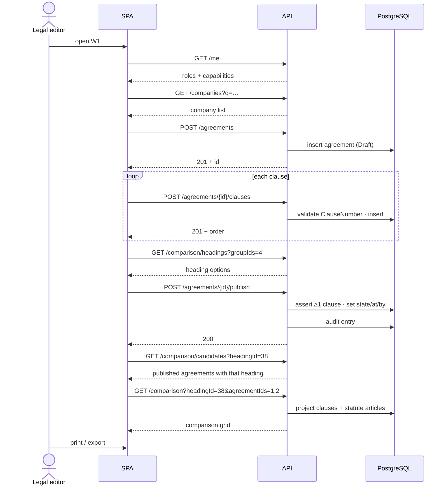

# API contracts — Convenciones

**Status: proposed for approval.** The choices needing sign-off are marked **[A-nn]** and listed in
[decisions.md](decisions.md#decisions-requiring-approval).

Domain reference: [domain-model.md](domain-model.md). Authorization: [security-model.md](security-model.md).

---

## 1. Conventions

| Aspect | Decision |
|---|---|
| Style | REST over JSON, ASP.NET Core Minimal API endpoint groups per module |
| Base path | `/api/v1` |
| Versioning | Major version in the path. No content negotiation for versions **[A-23]** — the SPA and API ship together, so a second mechanism is unnecessary |
| Casing | `camelCase` JSON; `snake_case` database; `PascalCase` C# |
| Auth | `Authorization: Bearer <supabase-access-token>`; validated against Supabase JWKS |
| Content type | `application/json` except document upload |
| Correlation | `X-Correlation-Id` echoed and logged; generated by the API if absent |
| Timestamps | ISO-8601 with offset (`2026-01-31T10:00:00-04:00`), stored `timestamptz` |
| Dates | `yyyy-MM-dd` (`date` columns) |
| Nulls | Omitted vs `null`: **`null` is always emitted** for a null field so the SPA can distinguish absent-from-response (never happens) from null |
| Enums | Serialised as their string names, never as ints |

### 1.1 Idempotency

Mutating endpoints are **not** idempotent by default; promotion and publish are the exceptions, where a
repeat returns `409 Conflict` rather than duplicating. `[A-24]` No `Idempotency-Key` machinery in the
MVP: the SPA does not retry non-idempotent writes automatically, and TanStack Query is configured not to.

---

## 2. Error model

RFC 9457 `application/problem+json`, extended with a stable machine-readable `code` and field errors.

```json
{
  "type": "https://convenciones.app/errors/validation-failed",
  "title": "Validation failed",
  "status": 400,
  "code": "validation_failed",
  "detail": "One or more fields are invalid.",
  "instance": "/api/v1/agreements/42/clauses",
  "correlationId": "0HN7…",
  "errors": {
    "number": ["Clause number 12 already exists in this agreement."],
    "headingId": ["A comparison heading is required."]
  }
}
```

### 2.1 Code catalogue

| HTTP | `code` | When |
|---|---|---|
| 400 | `validation_failed` | Field or cross-field validation; `errors` populated |
| 400 | `malformed_request` | Unparseable body / wrong content type |
| 401 | `unauthenticated` | Missing, expired or invalid token |
| 403 | `capability_required` | Authenticated but lacks the capability; `detail` names it |
| 404 | `not_found` | Entity absent **or not visible to the caller** (deliberately indistinguishable, to avoid leaking existence) |
| 409 | `conflict` | Unique violation (duplicate clause number, company code) |
| 409 | `invalid_state` | State machine rejects the transition (publish with no clauses, close without agreements, reopen when promoted) |
| 409 | `concurrent_modification` | Optimistic concurrency token mismatch |
| 413 | `payload_too_large` | Document exceeds the configured limit |
| 415 | `unsupported_media_type` | Document type not in the allow-list |
| 500 | `internal_error` | Never leaks exception detail; `correlationId` is the support handle |

**Rule:** no endpoint returns a bare status without a problem body. The legacy system's silent failures
— where `execute()` returned `true` regardless of outcome (Phase 1 §S13) — are the specific defect this
replaces, so every failure is observable by the caller.

### 2.2 Success envelopes

Single resource: the resource object directly (`200`). Created: the resource plus `Location` header
(`201`). Collections: `{ "items": [...], "page": {...} }`. No wrapper ceremony around single resources
**[A-25]**.

---

## 3. Validation strategy

Validation lives in **three places with one source of truth per rule**, and deliberately uses no
validation library **[A-26]**:

| Rule kind | Where | Example |
|---|---|---|
| Value-object invariants | Domain constructors | `DateRange.End >= Start`; `ClauseNumber` parses |
| Aggregate invariants | Domain methods | publish requires ≥ 1 clause |
| Request shape and required fields | Application-layer guards | `Title` required, ≤ 300 chars |
| Mirrored client-side | Zod schemas in the SPA | Same constraints, for instant feedback |

Cross-field and state rules are **never** trusted from the client — the SPA's Zod schema is a
convenience, never a control. A validation library would duplicate what value objects already express;
if the rule surface grows past roughly 50 distinct rules, revisit.

---

## 4. Endpoint catalogue

`Cap` = required capability. `[public]` = anonymous. All other endpoints require authentication.

### 4.1 Identity

| Method | Path | Cap | Purpose |
|---|---|---|---|
| `GET` | `/auth/bootstrap/status` | `[public]` | Whether a SuperAdmin exists (drives first-run UI) |
| `POST` | `/auth/bootstrap` | `[public, one-time]` | Create the single SuperAdmin (Art. VI.6) |
| `GET` | `/me` | — | Current user, profile, roles, effective capabilities |
| `GET` | `/users` · `POST` `/users` | `user.manage` | List / invite |
| `PATCH` | `/users/{id}` | `user.manage` | Update profile, block, set expiry |
| `PUT` | `/users/{id}/roles` | `user.manage` | Replace role set |
| `GET` | `/roles` · `POST` `/roles` | `role.manage` | |
| `GET` | `/capabilities` | `role.manage` | Catalogue |
| `PUT` | `/roles/{id}/capabilities` | `role.manage` | Replace grants |

**`POST /auth/bootstrap` contract:** accepted only when no SuperAdmin exists; otherwise `409
invalid_state`. Body: `{ email, displayName, password }`. The password is forwarded to Supabase Auth and
never stored (Art. VI.6). Idempotent by rejection, not by silent success.

### 4.2 Catalog

| Method | Path | Cap | Purpose |
|---|---|---|---|
| `GET` | `/companies` | `company.read` | Paged, filterable by `q`, sector, type |
| `POST` | `/companies` | `company.write` | |
| `GET` `PATCH` | `/companies/{id}` | `company.read` / `.write` | |
| `GET` | `/reference/countries` | `[public]` | Seed reference data |
| `GET` | `/reference/countries/{id}/states` | `[public]` | |
| `GET` | `/reference/states/{id}/municipalities` | `[public]` | |
| `GET` `POST` | `/catalog/sectors` · `/catalog/types` · `/catalog/categories` · `/catalog/activities` | `catalog.read` / `.write` | |

`GET /reference/*` is public: it is non-sensitive geography used by the public portal's company
displays and by unauthenticated registration forms later.

### 4.3 Agreements

| Method | Path | Cap | Purpose |
|---|---|---|---|
| `GET` | `/agreements` | `agreement.read` | Paged; `companyId`, `state`, `q` |
| `POST` | `/agreements` | `agreement.write` | |
| `GET` `PATCH` | `/agreements/{id}` | `agreement.read` / `.write` | |
| `POST` | `/agreements/{id}/publish` | `agreement.publish` | |
| `POST` | `/agreements/{id}/unpublish` | `agreement.publish` | |
| `GET` `POST` | `/agreements/{id}/clauses` | `.read` / `.write` | |
| `GET` `PATCH` `DELETE` | `/agreements/{id}/clauses/{clauseId}` | |
| `PUT` | `/agreements/{id}/clauses/{clauseId}/heading` | `agreement.write` | Reclassify only |
| `GET` `POST` | `/agreements/{id}/annexes` | `.read` / `.write` | |
| `PATCH` `DELETE` | `/agreements/{id}/annexes/{annexId}` | |
| `GET` | `/agreements/{id}/audit` | `audit.read` | Change history of the aggregate |

**Representative payloads**

```jsonc
// POST /agreements
{
  "companyId": 12,
  "title": "Convención Colectiva 2026-2028",
  "number": "2026-2028",
  "validFrom": "2026-01-01",
  "validTo": "2028-12-31",
  "scope": "Nacional"
}
// 201 → { "id": 42, "state": "Draft", "clauseCount": 0, … }

// POST /agreements/42/clauses
{
  "number": "12-A",
  "title": "Bono de alimentación",
  "summary": "…",
  "body": "<p>…</p>",
  "headingId": 38,
  "economicComparisonNote": "…",
  "isExcludedFromCompilation": false
}
// 201 → { "id": 501, "number": "12-A", "order": 1201, … }
```

`number` is accepted as a string and parsed by `ClauseNumber` — `"012"`, `"12"` and `"12-A"` are all
valid requests; `"5 555"` is a `400 validation_failed`. The response's `order` is the derived sort key,
so the client never sorts.

### 4.4 Comparison

| Method | Path | Cap | Purpose |
|---|---|---|---|
| `GET` | `/comparison/heading-groups` | `comparison.read` | Blocks, with `requiresEconomicComparison` |
| `GET` | `/comparison/headings?groupIds=&includeExcluded=false` | `comparison.read` | |
| `GET` | `/comparison/candidates?headingId=` | `comparison.read` | Published agreements having ≥ 1 clause for the heading |
| `GET` | `/comparison?headingId=&agreementIds=1,2,3` | `comparison.read` | The comparison grid |

```jsonc
// GET /comparison?headingId=38&agreementIds=1,2
{
  "heading": { "id": 38, "name": "Contribución a Sindicato", "isExcluded": false },
  "statuteArticles": [
    { "statuteId": 3, "statuteName": "LOTTT", "articleNumber": "…", "title": "…", "body": "…" }
  ],
  "agreements": [
    { "agreementId": 1, "title": "…", "companyName": "…",
      "clauses": [ { "clauseId": 501, "number": "38", "order": 3800, "title": "…", "body": "…" } ] },
    { "agreementId": 2, "title": "…", "companyName": "…", "clauses": [] }
  ],
  "unpublishedRequested": []
}
```

**`AC-W1.8` is enforced here:** any `agreementIds` entry that is not published is dropped into
`unpublishedRequested` rather than silently included or 404'd — the caller learns why a column is
missing. `[A-27]` Alternatively return `409 invalid_state`. I prefer the explicit list because it is
observable and testable both ways.

**No writes.** This endpoint is the product's read surface; it is deliberately the only one with a
bespoke shaped response instead of per-resource DTOs.

### 4.5 Legal library

| Method | Path | Cap |
|---|---|---|
| `GET` `POST` | `/statutes` | `statute.read` / `.write` |
| `GET` `PATCH` | `/statutes/{id}` | |
| `GET` `POST` | `/statutes/{id}/articles` | |
| `GET` `PATCH` `DELETE` | `/statutes/{id}/articles/{articleId}` | |

`statute.kind` is `LabourLaw` or `OtherStatute` — the fold of `ley_trabajo` and `otras_leyes`.

### 4.6 Negotiation

| Method | Path | Cap | Purpose |
|---|---|---|---|
| `GET` `POST` | `/negotiation/cases` | `negotiation.read` / `.write` | |
| `GET` | `/negotiation/cases/{id}` | `negotiation.read` | Full case with parties, petitions, meetings |
| `POST` `DELETE` | `/negotiation/cases/{id}/parties[/{partyId}]` | `negotiation.write` | |
| `POST` | `/negotiation/cases/{id}/open` · `/close` · `/reopen` · `/promote` | `negotiation.write` / `.promote` | Transitions |
| `GET` `POST` | `/negotiation/cases/{id}/petitions` | `.read` / `.write` | |
| `PATCH` | `/negotiation/cases/{id}/petitions/{petitionId}` | `.write` | Rejected when `Agreed` (INV-N3) |
| `POST` | `/negotiation/cases/{id}/petitions/{petitionId}/offers` | `.write` | |
| `POST` | `/negotiation/cases/{id}/meetings` | `.write` | |
| `POST` | `/negotiation/cases/{id}/petitions/{petitionId}/agreements` | `.write` | Records a `MeetingAgreement` |
| `POST` | `/negotiation/cases/{id}/promote` | `negotiation.promote` | Returns `{ agreementId }` |

`POST /promote` returns `409 invalid_state` if the case is not `Closed`, and `409 conflict` if already
promoted (INV-N7) — never a duplicate agreement.

### 4.7 Publishing and public portal

| Method | Path | Cap | Purpose |
|---|---|---|---|
| `GET` | `/public/agreements` | `[public]` | Published agreements, paged |
| `GET` | `/public/agreements/{id}` | `[public]` | Published agreement + clauses; `404` if unpublished |
| `GET` | `/public/news` · `/public/news/{id}` | `[public]` | |
| `GET` `POST` | `/news` | `news.read` / `.write` | Admin list / create |
| `PATCH` | `/news/{id}` | `news.write` | |
| `POST` | `/news/{id}/publish` · `/unpublish` | `news.publish` | |

The public endpoints are the **only** anonymous surface besides `/reference/*` and bootstrap. They
return a projection that omits internal identifiers, publisher identity and any draft data.

### 4.8 Documents and audit

| Method | Path | Cap | Purpose |
|---|---|---|---|
| `POST` | `/documents` | `document.write` | Upload; returns metadata + a storage path |
| `GET` | `/documents/{id}` | `document.read` | Metadata |
| `GET` | `/documents/{id}/download` | `document.read` | `302` to a short-lived signed URL |
| `DELETE` | `/documents/{id}` | `document.write` | Soft delete + storage removal |
| `POST` | `/documents/{id}/extract` | `document.write` | Runs extraction synchronously; `200` with the final state |
| `GET` | `/documents/{id}/extraction` | `document.read` | Extraction state: status, attempts, timestamps, error, `charCount` |
| `GET` | `/audit` | `audit.read` | Paged; `entityType`, `entityId`, `actorId`, date range |

**Upload contract:** `multipart/form-data` with a single `file` part. **PDF only.** Every other format —
JPEG, PNG, Word, text, archives — is rejected with **415 Unsupported Media Type**, including when the
request declares `application/pdf` and names the file `.pdf`. The format is decided by parsing the bytes,
never by the `Content-Type` header, the extension or the filename: the legacy system trusted
`$_FILES['type']` and wrote `chmod 0777` files into a web-served directory (Phase 1 §S7).

A `%PDF-` signature is not sufficient evidence. The bytes must parse as a PDF with a readable
cross-reference table and at least one page; a malformed, truncated or empty file is rejected with **400
`validation_failed`**.

Maximum size is **20 MiB (20,971,520 bytes)**, enforced server-side while receiving the request; anything
larger is **413 Content Too Large** and nothing is written to storage. Downloads are always served through a
short-lived signed URL, never from a public bucket path.

**Extraction contract (T5) — synchronous, `200 OK`.** `POST /documents/{id}/extract` performs the
extraction inside the request and answers **`200 OK`** with the resulting state. The MVP has no queue or
hosted worker, so it deliberately does **not** answer `202 Accepted` and there is nothing to poll for;
`GET /documents/{id}/extraction` returns the stored state for later reads. `202` + polling remains the
recorded design for a genuinely asynchronous extraction (FUT-01).

- A PDF with text becomes `Completed` and its text is stored with `charCount = length(content)`.
- A valid PDF with **no extractable text** becomes `Failed` with a reason and **no** text row; it is never
  reported as an empty success. Stored bytes that cannot be read become `Failed` with a reason.
- Re-extracting a `Completed` document is **`409 invalid_state`**, as is any attempt after the maximum of
  three. A failed attempt deletes any text left by a previous attempt, so obsolete content cannot be read.
- A caller without `document.write` gets **403**; a document belonging to another company gets **404**.

---

## 5. Concurrency

Optimistic concurrency using PostgreSQL's `xmin` system column mapped as a concurrency token, exposed as
`rowVersion` in responses and required on `PATCH`/`DELETE` via `If-Match`.

A mismatch returns `409 concurrent_modification`. **Justification:** the legacy system had no concurrency
control and silently lost one of two concurrent edits. Clause editing is exactly the multi-user,
long-dwell scenario where that matters (two editors on one 74-clause agreement).

```jsonc
// PATCH /agreements/42/clauses/501   If-Match: "1234"
{ "title": "…", "rowVersion": 1234 }
// 409 → { "code": "concurrent_modification", "detail": "…" }
```

**[A-29]** Alternative: last-write-wins with audit. Rejected because drift is the documented legacy
failure.

---

## 6. Pagination, filtering, sorting

| Collection | Strategy | Why |
|---|---|---|
| Clauses, audit entries, public agreements | **Keyset** (`?after=<cursor>&limit=`) | Unbounded growth; deep offset paging degrades and skips rows on concurrent inserts |
| Companies, statutes, catalogues, news | **Offset** (`?page=1&pageSize=25`) | Small, stable, and page counts are useful in the UI |

Both return:

```jsonc
{ "items": [ … ], "page": { "total": 5402, "limit": 25, "cursor": "eyJvIjo1MDAwfQ==", "hasMore": true } }
```

`total` is present for offset paging and **omitted** for keyset (counting a keyset set defeats its
purpose). Sorting is explicit and allow-listed per endpoint; unknown sort fields are `400`. The legacy
system interpolated `ORDER BY` fragments from the request (`contratos.php:71`), which was an injection
vector — the allow-list removes the class.

---

## 7. Primary workflow over the API



---

## 8. Contract testing

**[A-30]** The SPA's Zod schemas and the API's DTOs are kept in step by a **generated TypeScript client**
from the OpenAPI document the API emits at build time. That removes hand-written type drift without
introducing a shared-code layer. Alternative: hand-maintained types with a contract test that asserts
the OpenAPI document matches a committed snapshot. I recommend generation.

---

## 9. Frontend screens

Each screen maps to endpoints above; `Cap` is enforced in the UI for affordance **and** in the API for
control (never the UI alone — the legacy system's core failure, Phase 1 §S5).

| # | Screen | Route | Endpoints | Cap |
|---|---|---|---|---|
| S1 | Sign in | `/login` | Supabase Auth; `GET /me` | `[public]` |
| S2 | First-run setup | `/setup` | `/auth/bootstrap/status`, `/auth/bootstrap` | `[public]` |
| S3 | Dashboard | `/` | counts from `/agreements`, `/negotiation/cases` | — |
| S4 | Company list / editor | `/companies`, `/companies/:id` | `/companies` | `company.*` |
| S5 | Agreement list | `/agreements` | `GET /agreements` | `agreement.read` |
| S6 | Agreement detail | `/agreements/:id` | `GET /agreements/{id}` | `agreement.read` |
| S7 | **Clause workspace** | `/agreements/:id/clauses` | clause endpoints + `/comparison/headings` | `agreement.write` |
| S8 | Annexes | embedded in S6 | annex endpoints | `agreement.write` |
| S9 | **Comparison workspace** | `/comparison` | heading-groups, headings, candidates, comparison | `comparison.read` |
| S10 | Statute list / editor | `/statutes`, `/statutes/:id` | `/statutes` | `statute.*` |
| S11 | Negotiation case | `/negotiation/:id` | case + subset endpoints | `negotiation.*` |
| S12 | Users and roles | `/admin/users`, `/admin/roles` | identity endpoints | `user.manage`, `role.manage` |
| S13 | News admin | `/admin/news` | `/news` | `news.*` |
| S14 | Audit viewer | `/admin/audit` | `/audit` | `audit.read` |
| S15 | Public agreement | `/public/agreements/:id` | `/public/agreements/{id}` | `[public]` |
| S16 | Public portal home | `/` (anonymous) | `/public/agreements`, `/public/news` | `[public]` |

**S7 and S9 are the product.** S7 is where the work happens (74 clauses per agreement); it must support
fast keyboard-only clause entry, inline heading selection, and unsaved-changes protection. S9 is where
the value is realised and must render 2–5 agreement columns legibly at 1280 px with sticky headings.

**[A-31]** Confirm MUI-only (no data grid library beyond MUI's own `DataGrid`, which is MIT-licensed for
the community edition — S5/S10/S12 could use it).

---

## 10. API acceptance criteria

| ID | Criterion |
|---|---|
| **AC-A1** | Every error response is `application/problem+json` with `code`, `status`, `correlationId` |
| **AC-A2** | Every mutating endpoint returns `403 capability_required` for a caller lacking the capability, and `401` without a token |
| **AC-A3** | Unknown enum values, unknown sort fields and malformed bodies return `400` with a populated `errors` map |
| **AC-A4** | `POST /agreements/{id}/publish` on an agreement with zero clauses returns `409 invalid_state` |
| **AC-A5** | `POST /negotiation/cases/{id}/promote` twice returns `409` and creates exactly one agreement |
| **AC-A6** | `PATCH` with a stale `If-Match` returns `409 concurrent_modification` |
| **AC-A7** | `GET /comparison` excludes clauses whose heading has `isExcluded = true` |
| **AC-A8** | `GET /comparison` reports unpublished requested agreements in `unpublishedRequested` and includes no clauses for them |
| **AC-A9** | `GET /public/agreements/{id}` returns `404` for a draft agreement, for an anonymous caller |
| **AC-A10** | `POST /documents` rejects a `.exe` renamed `.pdf` (content-sniffed, not header-trusted) with `415` |
| **AC-A11** | The emitted OpenAPI document validates and the generated client compiles |
| **AC-A12** | `POST /documents/{id}/extract` returns `200` with the final state; a PDF with text becomes `Completed` and its stored `charCount` equals `length(content)` |
| **AC-A13** | A PDF with no extractable text, or unreadable stored bytes, becomes `Failed` with a reason and creates **no** `document_text` row |
| **AC-A14** | Re-extracting a `Completed` document and a fourth attempt both return `409`; `document.write` is required (`403`); another company's document is `404`; a failed attempt leaves no text behind |
