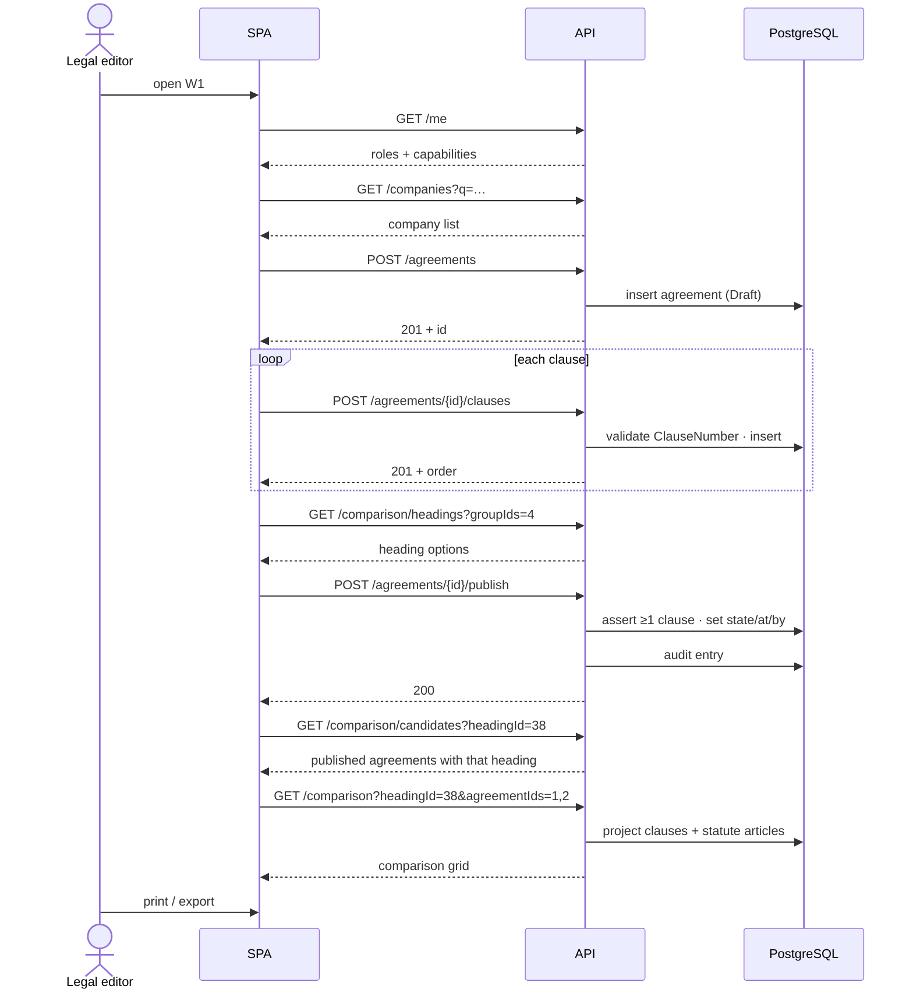

# API contracts — Convenciones

**Status: proposed for approval.** The choices needing sign-off are marked **[A-nn]** and listed in
[decisions.md](decisions.md#decisions-requiring-approval).

Domain reference: [domain-model.md](domain-model.md). Authorization: [security-model.md](security-model.md).

---

## 1. Conventions

| Aspect | Decision |
|---|---|
| Style | REST over JSON, ASP.NET Core Minimal API endpoint groups per module |
| Base path | `/api/v1` |
| Versioning | Major version in the path. No content negotiation for versions **[A-23]** — the SPA and API ship together, so a second mechanism is unnecessary |
| Casing | `camelCase` JSON; `snake_case` database; `PascalCase` C# |
| Auth | `Authorization: Bearer <supabase-access-token>`; validated against Supabase JWKS |
| Content type | `application/json` except document upload |
| Correlation | `X-Correlation-Id` echoed and logged; generated by the API if absent |
| Timestamps | ISO-8601 with offset (`2026-01-31T10:00:00-04:00`), stored `timestamptz` |
| Dates | `yyyy-MM-dd` (`date` columns) |
| Nulls | Omitted vs `null`: **`null` is always emitted** for a null field so the SPA can distinguish absent-from-response (never happens) from null |
| Enums | Serialised as their string names, never as ints |

### 1.1 Idempotency

Mutating endpoints are **not** idempotent by default; promotion and publish are the exceptions, where a
repeat returns `409 Conflict` rather than duplicating. `[A-24]` No `Idempotency-Key` machinery in the
MVP: the SPA does not retry non-idempotent writes automatically, and TanStack Query is configured not to.

---

## 2. Error model

RFC 9457 `application/problem+json`, extended with a stable machine-readable `code` and field errors.

```json
{
  "type": "https://convenciones.app/errors/validation-failed",
  "title": "Validation failed",
  "status": 400,
  "code": "validation_failed",
  "detail": "One or more fields are invalid.",
  "instance": "/api/v1/agreements/42/clauses",
  "correlationId": "0HN7…",
  "errors": {
    "number": ["Clause number 12 already exists in this agreement."],
    "headingId": ["A comparison heading is required."]
  }
}
```

### 2.1 Code catalogue

| HTTP | `code` | When |
|---|---|---|
| 400 | `validation_failed` | Field or cross-field validation; `errors` populated |
| 400 | `malformed_request` | Unparseable body / wrong content type |
| 401 | `unauthenticated` | Missing, expired or invalid token |
| 403 | `capability_required` | Authenticated but lacks the capability; `detail` names it |
| 404 | `not_found` | Entity absent **or not visible to the caller** (deliberately indistinguishable, to avoid leaking existence) |
| 409 | `conflict` | Unique violation (duplicate clause number, company code) |
| 409 | `invalid_state` | State machine rejects the transition (publish with no clauses, close without agreements, reopen when promoted) |
| 409 | `concurrent_modification` | Optimistic concurrency token mismatch |
| 413 | `payload_too_large` | Document exceeds the configured limit |
| 415 | `unsupported_media_type` | Document type not in the allow-list |
| 500 | `internal_error` | Never leaks exception detail; `correlationId` is the support handle |

**Rule:** no endpoint returns a bare status without a problem body. The legacy system's silent failures
— where `execute()` returned `true` regardless of outcome (Phase 1 §S13) — are the specific defect this
replaces, so every failure is observable by the caller.

**Refusals the framework makes before an endpoint runs.** A body the binder cannot read, or a parameter
it cannot bind, is **400 `malformed_request`**; a content type the endpoint does not accept is **415
`unsupported_media_type`**. Both keep the status the framework chose — nothing is remapped, and
`401`/`403`/`404`/`405` are untouched — and gain the problem body, so the rule above holds for them too.
A handler that refuses an oversized payload (a document over the 20 MiB business limit) answers **413
`payload_too_large`** itself. A body above the *transport* limit (22 MiB) is stopped by the server before
the API can answer consistently; that pre-existing gap is recorded in T10's task record §10.

### 2.2 Success envelopes

Single resource: the resource object directly (`200`). Created: the resource plus `Location` header
(`201`). Collections: `{ "items": [...], "page": {...} }`. No wrapper ceremony around single resources
**[A-25]**.

---

## 3. Validation strategy

Validation lives in **three places with one source of truth per rule**, and deliberately uses no
validation library **[A-26]**:

| Rule kind | Where | Example |
|---|---|---|
| Value-object invariants | Domain constructors | `DateRange.End >= Start`; `ClauseNumber` parses |
| Aggregate invariants | Domain methods | publish requires ≥ 1 clause |
| Request shape and required fields | Application-layer guards | `Title` required, ≤ 300 chars |
| Mirrored client-side | Zod schemas in the SPA | Same constraints, for instant feedback |

Cross-field and state rules are **never** trusted from the client — the SPA's Zod schema is a
convenience, never a control. A validation library would duplicate what value objects already express;
if the rule surface grows past roughly 50 distinct rules, revisit.

---

## 4. Endpoint catalogue

`Cap` = required capability. `[public]` = anonymous. All other endpoints require authentication.

### 4.1 Identity and administration

| Method | Path | Cap | Purpose |
|---|---|---|---|
| `GET` | `/auth/bootstrap/status` | `[public]` | Whether the system is configured (drives first-run UI) |
| `POST` | `/auth/bootstrap` | `[public, one-time]` | Create the single SuperAdmin (Art. VI.6) |
| `GET` | `/me` | — | Current user, profile, roles, effective capabilities |
| `GET` `POST` | `/users` | `user.manage` | List (paged, `q`) / provision |
| `GET` `PATCH` `DELETE` | `/users/{id}` | `user.manage` | Detail / partial update / delete |
| `PUT` | `/users/{id}/roles` | `user.manage` | Replace the role set |
| `GET` | `/roles` · `/capabilities` | `role.manage` | The role × capability matrix, read-only in the MVP |
| `GET` | `/audit` | `audit.read` | Paged audit trail with filters |

**`POST /auth/bootstrap` contract.** Body: `{ subject, email, displayName }`. `subject` is the Supabase
Auth user id (`sub`) the account will be known by — the API does **not** create the Supabase Auth user.
There is **no password**: Supabase Auth owns credentials, the database has no password column, and no
endpoint accepts or returns one. An operator creates the auth user in Supabase (dashboard or Admin API,
which is not part of this service) and provisions the account here with that subject.

The call is accepted only while **no account exists**, and the guard is the database:
`platform.bootstrap_first_admin` takes an exclusive lock on `platform.user_account`, re-checks under the
lock, refuses with `22023`, and otherwise writes the account, its empty profile, the SuperAdmin grant and
an audit row in one statement. A second call — including two concurrent ones — is **409 `invalid_state`**.
Idempotent by rejection, not by silent success.

**Users.** Provisioning takes `{ subject, email, displayName, phone?, companyId?, roleKeys?,
isBlocked?, expiresOn? }`; an unknown role key is **400**, an already-provisioned subject is **409**.
`PATCH` is partial (`displayName`, `email`, `phone`, `companyId`, `isBlocked`, `expiresOn`): an absent
field is kept, an explicit `null` clears a nullable one, and `null` for a required one is **400**.
Blocking is live: an existing token stops working on the **next request** because the session is resolved
from the database each time.

**Self-lockout is prevented, not repaired.** An administrator cannot block or delete their own account,
and cannot replace their own roles with a set that grants no administrative capability — each is **409**.
The database does not repeat this check, because it depends on the caller rather than on the row; a
direct SQL self-lockout remains possible for whoever holds the database credentials, which is why the
supported path is the endpoint.

**Audit trail.** `GET /audit?module=&entityType=&entityId=&actorId=&from=&to=&page=&pageSize=` returns
`{ items, page, pageSize, total }`, newest first; each item carries the actor (id and display name), the
resource it refers to, the action, `fromState`/`toState` and the `changes` object. It is append-only at
the database (no update or delete path exists) and invisible without `audit.read` (**403**). The per-
agreement view is this endpoint with `entityType=agreement&entityId=…`.

**Role matrix.** `GET /roles` returns each role with its capability keys and `isSystem`; `GET
/capabilities` returns the catalogue. Writing roles and grants (`POST /roles`, `PUT
/roles/{id}/capabilities`) is deliberately **not** part of the MVP: the screen shows the matrix, and the
seeded roles are the product's own.
### 4.2 Catalog

| Method | Path | Cap | Purpose |
|---|---|---|---|
| `GET` | `/companies` | `company.read` | Paged, filterable by `q`, sector, type |
| `POST` | `/companies` | `company.write` | |
| `GET` `PATCH` | `/companies/{id}` | `company.read` / `.write` | |
| `GET` | `/reference/countries` | `[public]` | Seed reference data |
| `GET` | `/reference/countries/{id}/states` | `[public]` | |
| `GET` | `/reference/states/{id}/municipalities` | `[public]` | |
| `GET` `POST` | `/catalog/sectors` · `/catalog/types` · `/catalog/categories` · `/catalog/activities` | `catalog.read` / `.write` | |

`GET /reference/*` is public: it is non-sensitive geography used by the public portal's company
displays and by unauthenticated registration forms later.

### 4.3 Agreements

| Method | Path | Cap | Purpose |
|---|---|---|---|
| `GET` | `/agreements` | `agreement.read` | Paged; `companyId`, `state` (`Draft`/`Published`), `q` |
| `POST` | `/agreements` | `agreement.write` | Body: `companyId?`, `validFrom`, `validTo?`, `scope` |
| `GET` `PATCH` | `/agreements/{id}` | `agreement.read` / `.write` | PATCH requires `If-Match` |
| `POST` | `/agreements/{id}/publish` | `agreement.publish` | Requires ≥ 1 clause |
| `POST` | `/agreements/{id}/unpublish` | `agreement.publish` | Clears the published act |
| `GET` `POST` | `/agreements/{id}/clauses` | `.read` / `.write` | Numeric order on read |
| `GET` `PATCH` `DELETE` | `/agreements/{id}/clauses/{clauseId}` | `.read` / `.write` | PATCH/DELETE require `If-Match` |
| `PUT` | `/agreements/{id}/clauses/{clauseId}/heading` | `agreement.write` | Reclassify only; requires `If-Match` |
| `GET` `POST` | `/agreements/{id}/annexes` | `.read` / `.write` | Metadata |
| `PATCH` `DELETE` | `/agreements/{id}/annexes/{annexId}` | `agreement.write` | Require `If-Match` |
| `GET` | `/agreements/{id}/audit` | `audit.read` | T13 |
| `GET` | `/comparison/headings` | `comparison.read` | Taxonomy for clause classification; T8 read-only |

**Representative payloads**

```jsonc
// POST /agreements
{
  "companyId": null,                 // null = the caller's company
  "validFrom": "2026-01-01",
  "validTo": "2028-12-31",
  "scope": "Nacional"
}
// 201 → {
//   "id": "…", "companyId": "…", "companyName": "…",
//   "title": "Empresa · 2026–2028",   // composed on read; never stored (Q-1)
//   "state": "Draft", "clauseCount": 0, "rowVersion": 1234, …
// }

// POST /agreements/{id}/clauses
{
  "number": 12,                      // integer only (Q-2)
  "title": "Bono de alimentación",
  "summary": "…",
  "body": "…",
  "headingId": "…",                  // required (Q-3/A-16)
  "economicComparisonNote": "…",
  "isExcludedFromCompilation": false,
  "exclusionNote": null
}
// 201 → { "id": "…", "number": 12, "headingName": "…", "rowVersion": 1234, … }
```

`number` is an integer: `"12"`, `"012"` and `"12-A"` are not accepted, and the response has no
string sort key — ordering is numeric by the database and the query (`2` before `10`). A duplicate
number within one agreement is **409 `conflict`**; clause 0 is **400 `validation_failed`**; a missing,
unknown or inactive heading is **400 `validation_failed`**.

**Identity and title (Q-1).** An agreement is identified by `(companyId, validFrom)`; a second
agreement with the same pair is **409 `conflict`**, and the database unique index refuses it as well.
The display title is composed from the company's **current** name and the validity period on every
read. There is no `title` or `number` column to drift.

**Publication (Q-7).** `POST /publish` requires `agreement.publish`; without it the response is
**403** and the row is unchanged. The transition records `publishedAt` and `publishedBy`; it is
refused with **409 `invalid_state`** when the agreement is already published or has no clauses.
`POST /unpublish` clears both fields and is refused on a draft. Each transition writes exactly one
audit entry. The database enforces the same capability with
`app.guard_agreement_publication`, so a direct SQL update by a caller without the capability fails.

**Tenancy.** Another company's agreement, clause or annex is **404** on every read or write. Creating
an agreement for a company the caller cannot access is **403**: there is no existing row to hide.
The database policy scopes all three tables by company as well.

### 4.4 Comparison

| Method | Path | Cap | Purpose |
|---|---|---|---|
| `GET` | `/comparison/heading-groups` | `comparison.read` | Active blocks, ordered, with `requiresEconomicComparison` |
| `GET` | `/comparison/headings?groupIds=&includeExcluded=false` | `comparison.read` | Taxonomy; implemented in T8 |
| `GET` | `/comparison/candidates?headingId=&companyId=&page=&pageSize=` | `comparison.read` | Published agreements having ≥ 1 clause for the heading |
| `GET` | `/comparison?headingId=&agreementIds=&page=&pageSize=` | `comparison.read` + `statute.read` | The adjacency projection |

All routes are **GET-only**; `POST`/`PUT /comparison` return **405**. The projection is read-only and
every query is `AsNoTracking`.

**Why the projection needs two capabilities.** `GET /comparison` returns the text of the statute
articles classified under the heading, so it requires **both** `comparison.read` and `statute.read`:
a capability gates the data it names, not the screen the data appears on. The other comparison routes
return no statutory text and still take `comparison.read` alone. A caller holding only
`comparison.read` therefore gets **403 `forbidden`** naming `statute.read`, while the candidates and
taxonomy routes keep working for it (T10 review, ADR-024).

```jsonc
// GET /comparison?headingId=…&agreementIds=id1,id2&page=1&pageSize=5
{
  "heading": {
    "id": "…", "groupId": "…", "groupName": "GENERALES", "name": "Salarios",
    "isExcluded": false, "requiresEconomicComparison": false, "sortOrder": 10
  },
  "statuteArticles": [                 // T10; empty when no statute article is classified here
    {
      "statuteId": "…", "statuteName": "Código del Trabajo", "statuteKind": "LabourLaw",
      "articleId": "…", "number": 12, "title": "Artículo 12 — Vacaciones",
      "body": "…", "economicComparisonNote": null
    }
  ],
  // How many statute articles this projection has in scope for the heading. The array is bounded at
  // 100, so `statuteArticleTotal > statuteArticles.length` means the answer was truncated. It is the
  // rendered scope, not a count of the library: an excluded heading reports 0, because nothing is
  // offered for comparison there.
  "statuteArticleTotal": 1,
  "agreements": [
    {
      "agreementId": "…", "companyId": "…", "companyName": "…",
      "title": "Empresa · 2026–2028",
      "validFrom": "2026-01-01", "validTo": "2028-12-31",
      "clauses": [
        { "clauseId": "…", "number": 2, "title": "…", "summary": "…", "body": "…",
          "economicComparisonNote": "…", "isExcludedFromCompilation": false }
      ]
    }
  ],
  "unpublishedRequested": [],
  "page": 1, "pageSize": 5, "total": 2
}
```

**Adjacency, not alignment (Q-6).** Each agreement is a column; clauses sit inside their own
agreement. No clause is paired with a clause in another agreement. The UI must not imply pairing; R2-01
is the alignment feature.

**Excluded headings.** A heading with `is_excluded = true` ("No Compara") produces no candidates and no
comparison rows. The comparison responds **200** with an empty `agreements` array and
`heading.isExcluded = true`, so the caller sees why. The test creates a published clause under that
heading and asserts its title and body are absent. `isExcludedFromCompilation` on a clause is a
different flag (compiled-document exclusion) and is not a comparison filter.

**Published only.** An unpublished requested agreement is never rendered, even for a caller who can
read drafts. It is reported in **`unpublishedRequested`** rather than silently included or 404'd
(AC-W1.8). Candidates exclude drafts too. `unpublishedRequested` is outside the page.

**Paging and bounds.** Candidates: default 10, max 50. Comparison: default 5, max 10 agreements per
page; at most 50 distinct `agreementIds`, and missing/invalid ids are **400 `validation_failed`**. The
caller chooses one heading and a bounded set of columns, so a company with hundreds of clauses cannot
make one request return the corpus.

**Stable order.** Candidates and agreement columns by `validFrom` descending then id; clauses by
numeric number ascending; heading groups by `sortOrder` then name.

**Tenancy.** A normal user's candidates are restricted to their company; another `companyId` is
**404**. In the projection every requested agreement must be visible: one another-company or
nonexistent id makes the whole request **404**, with no partial data. `company.read_all` may compare
across companies.

### 4.5 Legal library

| Method | Path | Cap |
|---|---|---|
| `GET` `POST` | `/statutes` | `statute.read` / `.write` |
| `GET` `PATCH` | `/statutes/{id}` | `statute.read` / `.write` |
| `GET` `POST` | `/statutes/{id}/articles` | `statute.read` / `.write` |
| `GET` `PATCH` `DELETE` | `/statutes/{id}/articles/{articleId}` | `statute.read` / `.write` |

`statute.kind` is `LabourLaw` or `OtherStatute` — the fold of `ley_trabajo` and `otras_leyes`. It is
fixed at creation; `PATCH /statutes/{id}` covers name, publication date, source and document only.

```jsonc
// POST /statutes
{ "kind": "LabourLaw", "name": "Código del Trabajo", "publishedOn": "2012-05-07",
  "source": "Gaceta Oficial 6.076", "documentId": null }
// 201 → { "id": "…", "kind": "LabourLaw", "name": "…", "articleCount": 0, "rowVersion": 1, … }

// POST /statutes/{id}/articles
{ "number": 12, "title": "Artículo 12 — Vacaciones", "summary": null, "body": "…",
  "headingId": null, "economicComparisonNote": null }
// 201 → { "id": "…", "number": 12, "title": "…", "body": "…", "headingId": null, … }
```

**Reference data, not tenant data.** No statute or article belongs to a company, and no endpoint
applies a company filter: a caller of any company — and a caller with no company at all — reads the
same library. This is the deliberate difference from agreements, and it is the reason `statute.read`
exists separately from `agreement.read`. Writes require `statute.write`, enforced by the endpoint
declaration and again by the RLS policy.

**The single labour statute.** At most one `LabourLaw` statute exists. A second is **409 `conflict`**
and the problem's `detail` names the partial unique index `statute_single_labour_law_key` that refused
it; the request is not retried, de-dup'd or merged. The database, not the handler, is the guard,
because the rule spans rows.

**Article numbering.** `number` is an integer (`12`, never `"012"` or `"12-A"`), unique within a
statute (**409 `conflict`**, naming `statute_article_number_key`) and ordered numerically on read.
`number < 1` is **400 `validation_failed`**.

**The heading.** `title` — the article's own heading — is **required**: an article with a blank or
absent title is **400 `validation_failed`**, and the database CHECK refuses it too. `headingId` — the
comparison classification — is **optional** (approval A-12): `null` means unclassified and is accepted.
A supplied `headingId` must be an existing active heading, else **400**; an empty Guid is **400**, not
`null`. `PATCH` clears the classification only when `headingId` is sent as `null` (see below).

**`PATCH` is a partial update.** It follows the company endpoint's rule — a field that is not sent is
left unchanged — with the one thing a plain nullable property cannot express:

| What the body says | Effect |
|---|---|
| the field is **absent** | the stored value is kept |
| the field is **present with a value** | the value replaces the stored one |
| a **nullable** field is present as `null` | the field is cleared (`publishedOn`, `source`, `documentId`, `summary`, `headingId`, `economicComparisonNote`) |
| a **required** field is present as `null` | **400 `validation_failed`**, nothing changes (`name`, `number`, `title`, `body`) |

A rename that sends only `name` therefore cannot erase the publication date, the source or the
attached document, and the audit entry records only the fields that actually changed. `PATCH` and
`DELETE` require `If-Match` with the current `rowVersion` (**400** missing, **409
`concurrent_modification`** stale). No statute deletion is exposed: a statute owns its articles by
cascade.

**Malformed bodies.** A body the contract cannot bind — a number where a string is expected, invalid
JSON, a missing required parameter — is **400 `malformed_request`** as `application/problem+json`, with
a `code` and an `errors` map. It is never a bare status with an empty body (AC-A1, AC-A32).

### 4.6 Negotiation

| Method | Path | Cap |
|---|---|---|
| `GET` `POST` | `/negotiation/cases` | `negotiation.read` / `.write` |
| `GET` | `/negotiation/cases/{id}` | `negotiation.read` |
| `POST` `DELETE` | `/negotiation/cases/{id}/parties[/{partyId}]` | `negotiation.write` |
| `POST` | `/negotiation/cases/{id}/petitions` | `negotiation.write` |
| `PATCH` `DELETE` | `/negotiation/cases/{id}/petitions/{petitionId}` | `negotiation.write` |
| `PUT` | `/negotiation/cases/{id}/petitions/{petitionId}/state` | `negotiation.write` |
| `POST` `DELETE` | `/negotiation/cases/{id}/petitions/{petitionId}/offers[/{offerId}]` | `negotiation.write` |
| `POST` `DELETE` | `/negotiation/cases/{id}/meetings[/{meetingId}]` | `negotiation.write` |
| `POST` `DELETE` | `/negotiation/cases/{id}/petitions/{petitionId}/agreements[/{agreementId}]` | `negotiation.write` |
| `POST` | `/negotiation/cases/{id}/in-progress` · `/pending` · `/agree` | `negotiation.write` |
| `POST` | `/negotiation/cases/{id}/close` · `/reopen` | `negotiation.write` |
| `POST` | `/negotiation/cases/{id}/promote` | **`negotiation.promote`** |

**The state machine (Q-4, T11).** `Open → InProgress → Pending → Agreed → Closed`. A case is created
directly in `Open` — Q-4 removed `Draft`, so there is no state before `Open` and no `/open` operation.
The three middle states are entered by explicit operations with no business precondition beyond the
source state; `Agreed` is likewise an explicit act (no invented rules). `close` is only allowed from
`Agreed` and requires **at least one meeting agreement** — the rule named by `409 invalid_state` above
("close without agreements") and by INV-N2. `reopen` returns a `Closed` case to `InProgress` and clears
`closedAt`. Every other transition is **409 `invalid_state`**.

**A closed case is read-only.** Parties, petitions, offers, meetings and meeting agreements cannot be
created, edited or deleted while the case is `Closed`; reopen it first. This replaces the legacy
behaviour, where edit and delete handlers checked nothing and a closed case stayed fully editable.

```jsonc
// POST /negotiation/cases
{ "startedOn": "2026-01-01", "companyId": null }        // 201, state "Open"

// POST /negotiation/cases/{id}/petitions
{ "number": 1, "title": "Salarios", "body": "…", "headingId": null }

// PUT /negotiation/cases/{id}/petitions/{petitionId}/state
{ "state": "Agreed" }                                   // 200 with the petition

// POST /negotiation/cases/{id}/promote
{ "validFrom": "2026-06-01", "validTo": "2028-06-01", "scope": "Nacional" }
// 200 → { "agreementId": "…", "caseId": "…" }
```

**Promotion (T11).** It is a separate operation for an already-`Closed` case with no previous link. It
creates the agreement header through the agreement module's own rules (so `validFrom` and `scope` are
required and `validTo >= validFrom`), records `promotedAgreementId`, and leaves the state `Closed`. The
body dates are typed, so the legacy placeholders `*Inicio`/`*Fin` cannot be sent; a `scope` that looks
like a placeholder (`*Ambito`) is **400**. Meeting agreements are **not** copied into clauses: the case
is the negotiation record and clauses are authored in the agreement workspace. Promotion is terminal:
reopening a promoted case is **409 `invalid_state`**, and a second promotion is **409 `conflict`**. It
requires `negotiation.promote` (**403** without it), and the database guard refuses the same statement
with `42501` even when the API is bypassed.

**Illegal transitions name the current state.** A `409 invalid_state` carries a `state` extension with
the case's state at the time of the refusal:

```jsonc
{ "status": 409, "code": "invalid_state", "state": "InProgress",
  "detail": "The case is 'InProgress'. It can only be closed from Agreed." }
```

**Petition outcomes (Q-5).** The four documented outcomes are `Open`, `Agreed`, `Rejected`, `Withdrawn`.
The transition graph is not documented; the minimum consistent with the evidence is implemented: from
`Open` to any outcome, and `Agreed` back to `Open` (the legacy "reopen petition"). `Rejected` and
`Withdrawn` are terminal. An `Agreed` petition cannot be edited or deleted (**409 `conflict`**, INV-N3)
until it is set back to `Open`. Recording a meeting agreement does **not** change the petition state.

**A note on parties.** The domain model's INV-N1 (at least one union and one employer party before the
case can open) has no place in this lifecycle — nothing precedes `Open` — and enforcing it at creation
would be a new business rule. It is therefore **not enforced** yet; the decision is still open.
### 4.7 Publishing and public portal

| Method | Path | Cap | Purpose |
|---|---|---|---|
| `GET` | `/public/agreements` | `[public]` | Published agreements, paged |
| `GET` | `/public/agreements/{id}` | `[public]` | Published agreement + clauses + annexes; `404` if unpublished |
| `GET` | `/public/news` · `/public/news/{id}` | `[public]` | Published news, paged / detail; `404` if unpublished |
| `GET` | `/public/news/categories` | `[public]` | Active categories, for the portal navigation |
| `GET` `POST` | `/news` | `news.read` / `.write` | Admin list / create |
| `GET` | `/news/{id}` | `news.read` | Admin detail, drafts included |
| `PATCH` | `/news/{id}` | `news.write` | Partial update |
| `POST` | `/news/{id}/publish` · `/unpublish` | `news.publish` | Draft → Published / Published → Draft |
| `GET` `POST` | `/news/categories` | `news.read` / `.write` | Category list (all) / create |

**The public surface is an allow-list, not a serialised entity.** The projections are explicit record
types; a field added to the admin shape cannot reach the portal by accident. They contain:

- agreement summary: `id`, `title` (composed, never stored), `companyName`, `validFrom`, `validTo`,
  `scope`, `publishedAt`;
- agreement detail: the same plus `clauses[{number, title, summary, body}]` and
  `annexes[{name, description, body}]`;
- news summary: `id`, `title`, `summary`, `categoryName`, `publishedAt`; detail adds `body`.

No `companyId`, no internal identifiers beyond the resource id, no publisher identity, no audit columns,
no heading or document ids, no storage paths, no draft content. A draft agreement read by id is **404**,
indistinguishable from one that does not exist (AC-S7).

**Anonymous reads run on the `anon` database role.** The routes declare `AllowAnonymous()` *and*
`ServesPublicData()`. The second is what makes the request's connection run as `anon`, so the public RLS
policies are the filter and the handlers need no publication predicate. An endpoint that is merely
anonymous — bootstrap — keeps the login's privileges, because "anonymous" describes the caller, not what
the request may read.

**News publication is a privileged transition.** `POST /news/{id}/publish` requires `news.publish`;
without it **403**, and `app.guard_news_publication()` refuses the same UPDATE with `42501` even for the
API role. The database assigns `published_by` and `published_at` itself — the request has no such fields
(T12 AC 3) — and clears them on unpublish, because the table's consistency CHECK requires exactly that.
A news article is always created as a draft — the create route has no state field — and a direct
`INSERT` of a published row is refused by the guard. Unpublishing removes the article from every public
read immediately.

**Rich text is sanitised twice.** On write, with the allow-list library (A-33, AC-S10), and again in the
public projections, because the portal may serve rows written before that rule existed. Scripts, event
handlers, `javascript:` URLs, images and inline styles are removed; formatting and `http`/`https`/`mailto`
links survive, and links get `rel="nofollow noopener noreferrer"`.

**News is not company-scoped.** The schema has no `company_id` on `news_article` or `news_category`,
because published news is public. Any caller holding `news.read` sees every article, including drafts;
`news.write` edits, `news.publish` publishes. Categories are global reference data; the create route
enforces the case-insensitive unique name (**409**).
### 4.8 Documents and audit

| Method | Path | Cap | Purpose |
|---|---|---|---|
| `POST` | `/documents` | `document.write` | Upload; returns metadata (no storage path) |
| `GET` | `/documents` | `document.read` | Paged, company-scoped list; `{ items, page, pageSize, total }` |
| `GET` | `/documents/{id}` | `document.read` | Metadata, extraction state and `rowVersion` |
| `GET` | `/documents/{id}/text` | `document.read` | Extracted text; `404` when no text exists |
| `GET` | `/documents/{id}/download` | `document.read` | Streams the stored bytes (range enabled); never a path or permanent URL |
| `DELETE` | `/documents/{id}` | `document.write` | Soft delete + storage removal; `If-Match` required |
| `POST` | `/documents/{id}/extract` | `document.write` | Runs extraction synchronously; `200` with the final state |
| `GET` | `/documents/{id}/extraction` | `document.read` | Extraction state: status, attempts, timestamps, error, `charCount` |
| `GET` | `/audit` | `audit.read` | Paged; `entityType`, `entityId`, `actorId`, date range |

**Upload contract:** `multipart/form-data` with a single `file` part. **PDF only.** Every other format —
JPEG, PNG, Word, text, archives — is rejected with **415 Unsupported Media Type**, including when the
request declares `application/pdf` and names the file `.pdf`. The format is decided by parsing the bytes,
never by the `Content-Type` header, the extension or the filename: the legacy system trusted
`$_FILES['type']` and wrote `chmod 0777` files into a web-served directory (Phase 1 §S7).

A `%PDF-` signature is not sufficient evidence. The bytes must parse as a PDF with a readable
cross-reference table and at least one page; a malformed, truncated or empty file is rejected with **400
`validation_failed`**.

Maximum size is **20 MiB (20,971,520 bytes)**, enforced server-side while receiving the request; anything
larger is **413 Content Too Large** and nothing is written to storage. The upload response contains
metadata only — never `storage_path`, a public URL or the uploader.

**Extraction contract (T5) — synchronous, `200 OK`.** `POST /documents/{id}/extract` performs the
extraction inside the request and answers **`200 OK`** with the resulting state. The MVP has no queue or
hosted worker, so it deliberately does **not** answer `202 Accepted` and there is nothing to poll for;
`GET /documents/{id}/extraction` returns the stored state for later reads. `202` + polling remains the
recorded design for a genuinely asynchronous extraction (FUT-01).

- A PDF with text becomes `Completed` and its text is stored with `charCount = length(content)`.
- A valid PDF with **no extractable text** becomes `Failed` with a reason and **no** text row; it is never
  reported as an empty success. Stored bytes that cannot be read become `Failed` with a reason.
- Re-extracting a `Completed` document is **`409 invalid_state`**, as is any attempt after the maximum of
  three. A failed attempt deletes any text left by a previous attempt, so obsolete content cannot be read.
- A caller without `document.write` gets **403**; a document belonging to another company gets **404**.

**Retrieval contract (T6).**

- `GET /documents?page=1&pageSize=25` lists newest first, scoped to the caller's company. `total` is
  the number of **visible** rows, not the number that exist. A caller with no company (and no
  `company.read_all`) gets an empty page rather than an unfiltered one; `company.read_all` widens the
  list to every attributed document, and a null-company document remains visible to nobody. Each
  summary includes the extraction status, attempt count and the server-authored `extractionError`.
- `GET /documents/{id}` returns metadata, extraction state and `rowVersion`, and omits `storage_path`,
  `checksum` and `uploaded_by`.
- `GET /documents/{id}/text` returns `{ documentId, content, charCount, extractedAt }`. If no
  `document_text` row exists — never extracted, or extraction failed — it returns **404 `not_found`**,
  not an empty body and not a 500.
- `GET /documents/{id}/download` streams the bytes after the tenant check, with an attachment
  disposition, `Cache-Control: private, no-store` and range processing (`206` + `Content-Range`). It
  does not redirect, and it exposes neither the storage key nor a permanent URL. The signed-URL
  variant belongs to the Supabase Storage adapter (T18); the MVP local adapter is streamed by the API.
- `DELETE /documents/{id}` requires `If-Match` with the current `rowVersion`: missing → **400**,
  stale → **409 `concurrent_modification`**, current → **204**. The row is soft-deleted
  (`deleted_at`) and its audit trail survives; the object is removed after the row is hidden. Every
  read — list, metadata, text, download and extraction — then returns **404**.
- Cross-company access is **404** on every one of these endpoints, not 403: a 403 would confirm the
  document exists. The document is located before `If-Match` is read, so an omitted header cannot leak
  existence either.

---

## 5. Concurrency

Optimistic concurrency using PostgreSQL's `xmin` system column mapped as a concurrency token, exposed as
`rowVersion` in responses and required on `PATCH`/`DELETE` via `If-Match`.

A mismatch returns `409 concurrent_modification`. **Justification:** the legacy system had no concurrency
control and silently lost one of two concurrent edits. Clause editing is exactly the multi-user,
long-dwell scenario where that matters (two editors on one 74-clause agreement).

```jsonc
// PATCH /agreements/42/clauses/501   If-Match: "1234"
{ "title": "…", "rowVersion": 1234 }
// 409 → { "code": "concurrent_modification", "detail": "…" }
```

**[A-29]** Alternative: last-write-wins with audit. Rejected because drift is the documented legacy
failure.

---

## 6. Pagination, filtering, sorting

| Collection | Strategy | Why |
|---|---|---|
| Clauses, audit entries, public agreements | **Keyset** (`?after=<cursor>&limit=`) | Unbounded growth; deep offset paging degrades and skips rows on concurrent inserts |
| Companies, statutes, catalogues, news | **Offset** (`?page=1&pageSize=25`) | Small, stable, and page counts are useful in the UI |

Both return:

```jsonc
{ "items": [ … ], "page": { "total": 5402, "limit": 25, "cursor": "eyJvIjo1MDAwfQ==", "hasMore": true } }
```

`total` is present for offset paging and **omitted** for keyset (counting a keyset set defeats its
purpose). Sorting is explicit and allow-listed per endpoint; unknown sort fields are `400`. The legacy
system interpolated `ORDER BY` fragments from the request (`contratos.php:71`), which was an injection
vector — the allow-list removes the class.

---

## 7. Primary workflow over the API



---

## 8. Contract testing

**[A-30]** The SPA's Zod schemas and the API's DTOs are kept in step by a **generated TypeScript client**
from the OpenAPI document the API emits at build time. That removes hand-written type drift without
introducing a shared-code layer. Alternative: hand-maintained types with a contract test that asserts
the OpenAPI document matches a committed snapshot. I recommend generation.

---

## 9. Frontend screens

Each screen maps to endpoints above; `Cap` is enforced in the UI for affordance **and** in the API for
control (never the UI alone — the legacy system's core failure, Phase 1 §S5).

| # | Screen | Route | Endpoints | Cap |
|---|---|---|---|---|
| S1 | Sign in | `/login` | Supabase Auth; `GET /me` | `[public]` |
| — | **Document workflow (T7)** | `/documents` | `/me`, `/companies/{id}`, `GET`/`POST /documents`, `POST /{id}/extract`, `GET /{id}/text` | `document.read` / `document.write` |
| S2 | First-run setup | `/setup` | `/auth/bootstrap/status`, `/auth/bootstrap` | `[public]` |
| S3 | Dashboard | `/` | counts from `/agreements`, `/negotiation/cases` | — |
| S4 | Company list / editor | `/companies`, `/companies/:id` | `/companies` | `company.*` |
| S5 | Agreement list | `/agreements` | `GET /agreements` | `agreement.read` |
| S6 | Agreement detail | `/agreements/:id` | `GET /agreements/{id}` | `agreement.read` |
| S7 | **Clause workspace** | `/agreements/:id/clauses` | clause endpoints + `/comparison/headings` | `agreement.write` |
| S8 | Annexes | embedded in S6 | annex endpoints | `agreement.write` |
| S9 | **Comparison workspace** | `/comparison` | heading-groups, headings, candidates, comparison | `comparison.read` |
| S10 | Statute list / editor | `/statutes`, `/statutes/:id` | `/statutes` | `statute.*` |
| S11 | Negotiation case | `/negotiation/:id` | case + subset endpoints | `negotiation.*` |
| S12 | Users and roles | `/admin/users`, `/admin/roles` | identity endpoints | `user.manage`, `role.manage` |
| S13 | News admin | `/admin/news` | `/news` | `news.*` |
| S14 | Audit viewer | `/admin/audit` | `/audit` | `audit.read` |
| S15 | Public agreement | `/public/agreements/:id` | `/public/agreements/{id}` | `[public]` |
| S16 | Public portal home | `/` (anonymous) | `/public/agreements`, `/public/news` | `[public]` |

**S7 and S9 are the product.** S7 is where the work happens (74 clauses per agreement); it must support
fast keyboard-only clause entry, inline heading selection, and unsaved-changes protection. S9 is where
the value is realised and must render 2–5 agreement columns legibly at 1280 px with sticky headings.

**[A-31]** Confirm MUI-only (no data grid library beyond MUI's own `DataGrid`, which is MIT-licensed for
the community edition — S5/S10/S12 could use it).

---

## 10. API acceptance criteria

| ID | Criterion |
|---|---|
| **AC-A1** | Every error response is `application/problem+json` with `code`, `status`, `correlationId` |
| **AC-A2** | Every mutating endpoint returns `403 capability_required` for a caller lacking the capability, and `401` without a token |
| **AC-A3** | Unknown enum values, unknown sort fields and malformed bodies return `400` with a populated `errors` map |
| **AC-A4** | `POST /agreements/{id}/publish` on an agreement with zero clauses returns `409 invalid_state` |
| **AC-A5** | `POST /negotiation/cases/{id}/promote` twice returns `409` and creates exactly one agreement |
| **AC-A6** | `PATCH` with a stale `If-Match` returns `409 concurrent_modification` |
| **AC-A7** | `GET /comparison` excludes clauses whose heading has `isExcluded = true` |
| **AC-A8** | `GET /comparison` reports unpublished requested agreements in `unpublishedRequested` and includes no clauses for them |
| **AC-A9** | `GET /public/agreements/{id}` returns `404` for a draft agreement, for an anonymous caller |
| **AC-A10** | `POST /documents` rejects a `.exe` renamed `.pdf` (content-sniffed, not header-trusted) with `415` |
| **AC-A11** | The emitted OpenAPI document validates and the generated client compiles |
| **AC-A12** | `POST /documents/{id}/extract` returns `200` with the final state; a PDF with text becomes `Completed` and its stored `charCount` equals `length(content)` |
| **AC-A13** | A PDF with no extractable text, or unreadable stored bytes, becomes `Failed` with a reason and creates **no** `document_text` row |
| **AC-A14** | Re-extracting a `Completed` document and a fourth attempt both return `409`; `document.write` is required (`403`); another company's document is `404`; a failed attempt leaves no text behind |
| **AC-A15** | `GET /documents` returns only the caller's company's documents and a `total` equal to the visible row count; a caller with no company sees none |
| **AC-A16** | `GET /documents/{id}`, `/text`, `/download` and `DELETE` return `404` for another company's document; `/text` is `404` when no text exists; no response exposes `storage_path`, `checksum` or `uploaded_by` |
| **AC-A17** | `GET /documents/{id}/download` returns the stored bytes (and `206` for a range) without a redirect, storage key or permanent URL |
| **AC-A18** | `DELETE` requires the current `If-Match` (`400` missing, `409` stale, `204` success); a soft-deleted document is absent from the list and `404` everywhere, its object is removed, and its audit trail survives |
| **AC-A19** | Two agreements for one company with the same `validFrom` are `409 conflict`, and the database unique index refuses the duplicate as well |
| **AC-A20** | Clause numbers are positive integers, unique within the agreement (`409` duplicate), returned in numeric order; a missing or unknown heading is `400 validation_failed` |
| **AC-A21** | Publication requires `agreement.publish` (`403` and unchanged otherwise), records actor and timestamp, is refused with `409 invalid_state` on an empty/already-published agreement, and is audited exactly once; unpublishing clears both fields |
| **AC-A22** | The agreement title is composed from the company's current name and validity period and is not stored; another company's agreement is `404`, and creating one for a company the caller cannot access is `403` |
| **AC-A23** | A clause under an `is_excluded` heading is absent from comparison output and from candidates, and the JSON is asserted not to contain its title or body |
| **AC-A24** | An unpublished agreement is never rendered; it appears in `unpublishedRequested` and becomes visible after publication |
| **AC-A25** | The comparison is paged/bounded (candidate page ≤ 50, comparison page ≤ 10 agreements, ≤ 50 ids) and rejects invalid requests with `400`; the routes are GET-only (`405` otherwise) |
| **AC-A26** | Another company's agreement id makes the comparison `404` with no partial data; clauses are adjacent, never paired, and ordered by numeric number |
| **AC-A27** | A second `LabourLaw` statute is **409 `conflict`** whose `detail` names `statute_single_labour_law_key`, and the partial unique index refuses a direct insert with `23505` on that index |
| **AC-A28** | A statute article with no title is **400 `validation_failed`**; article numbers are integers, unique within a statute (**409**), ordered numerically, and `< 1` is **400**; an unclassified article (`headingId: null`) is accepted |
| **AC-A29** | An authenticated user of **any** company — and one with no company — reads every statute and article; without `statute.write` every write is **403**, and the RLS policy refuses the same write at the database |
| **AC-A30** | `PATCH` on a statute or article is partial: an absent field is unchanged (a rename preserves `publishedOn`, `source` and `documentId`), a nullable field sent as `null` is cleared, a required field sent as `null` is **400** with nothing changed, and the audit entry names only the fields that changed |
| **AC-A31** | `GET /comparison` requires **both** `comparison.read` and `statute.read`; a caller holding only `comparison.read` gets **403** naming `statute.read` from the projection while `/comparison/candidates` still answers `200` |
| **AC-A32** | A body that cannot be bound to the contract (invalid JSON, a number where a string is expected, a missing required parameter) is **400 `malformed_request`** as `application/problem+json` with a `code`, never a bare status |
