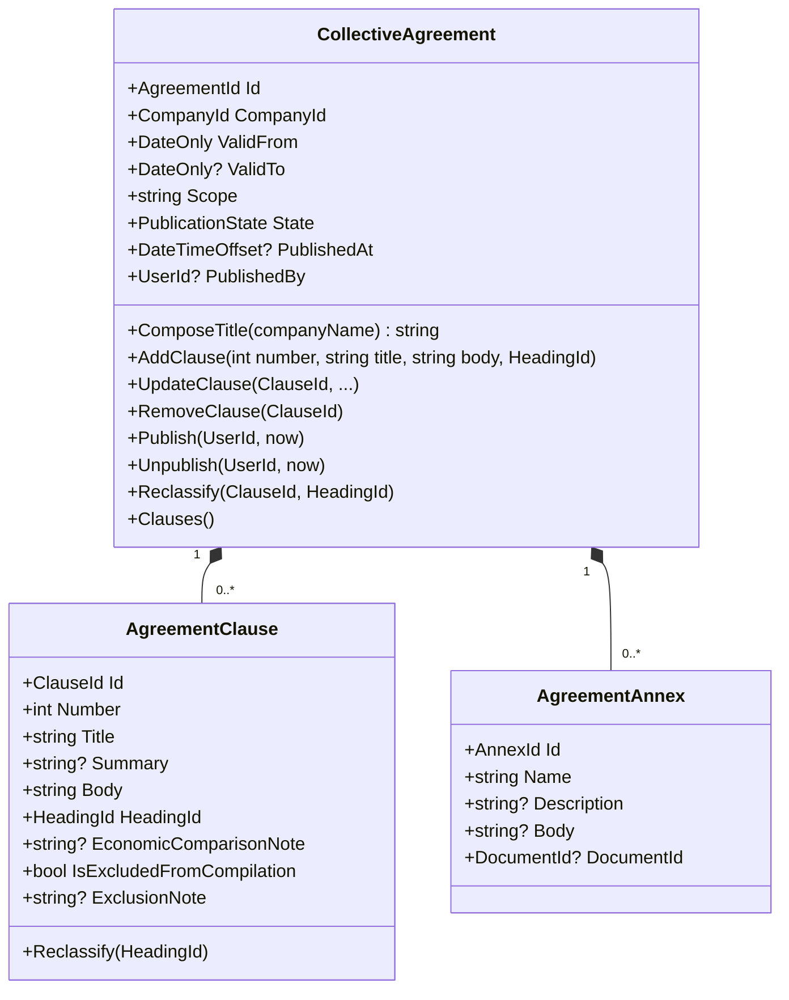
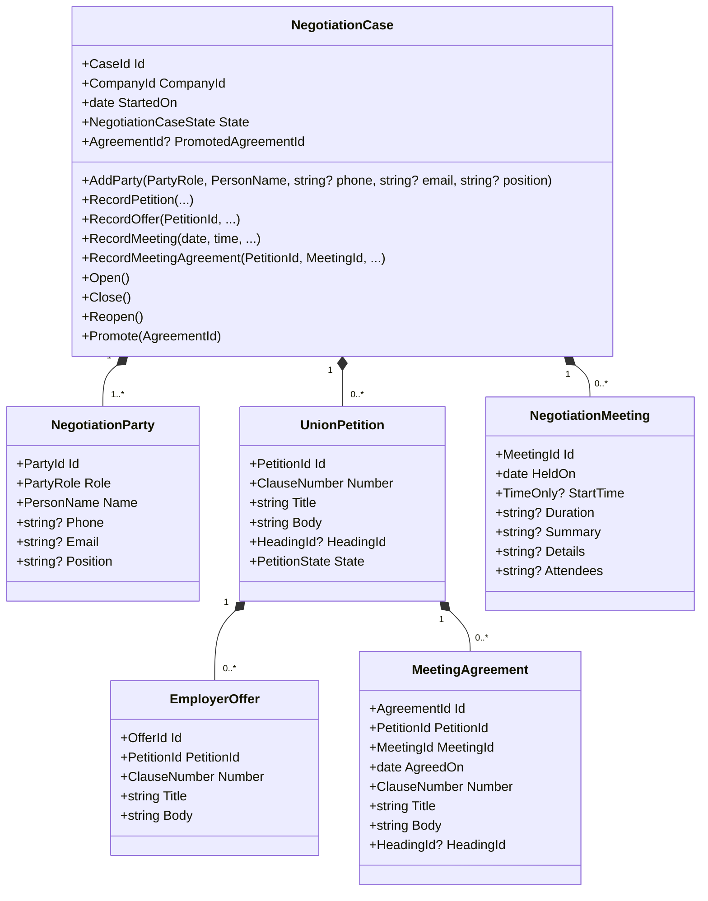
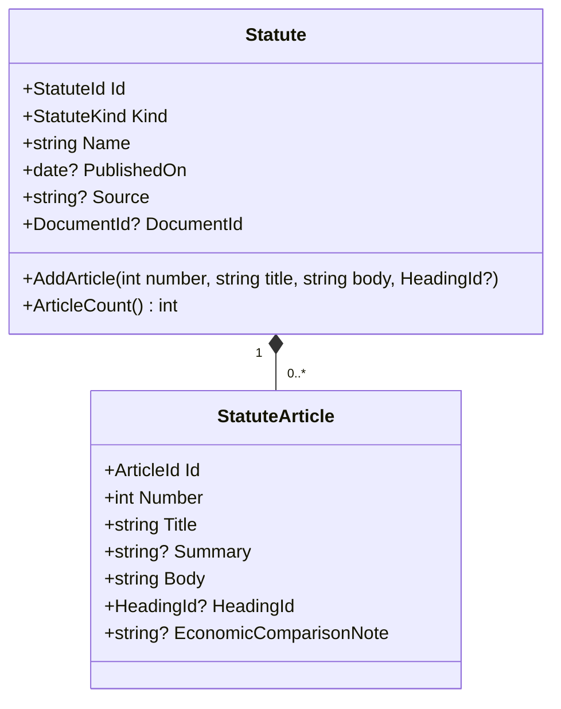
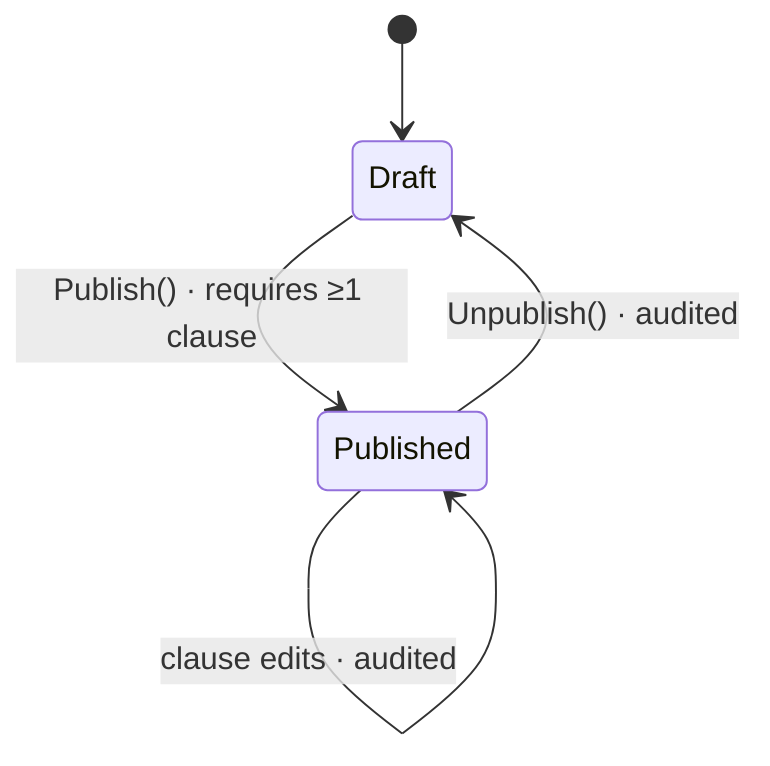
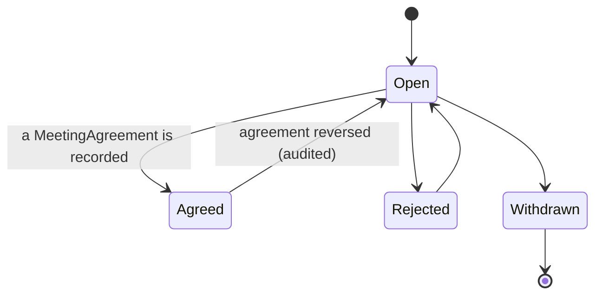
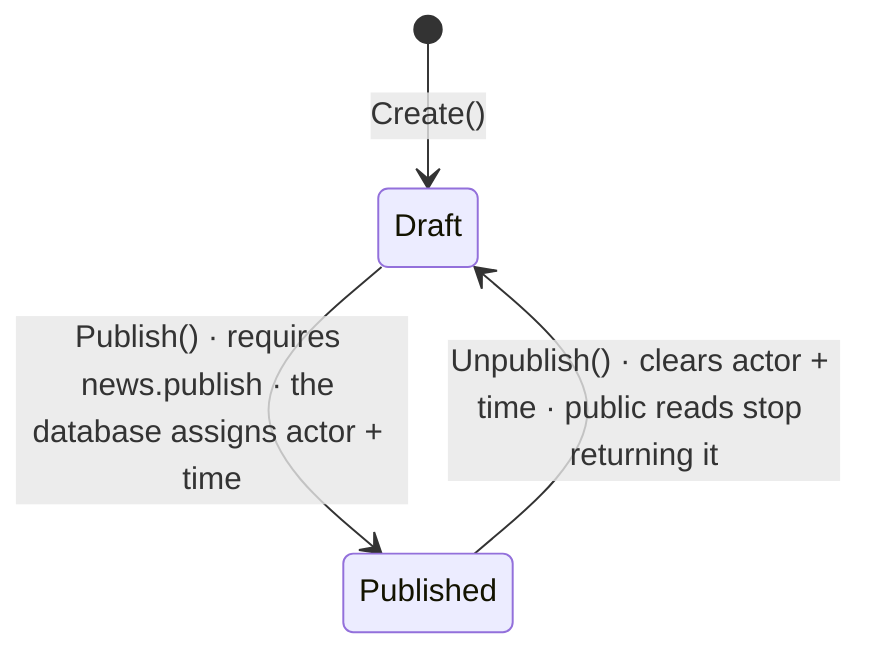
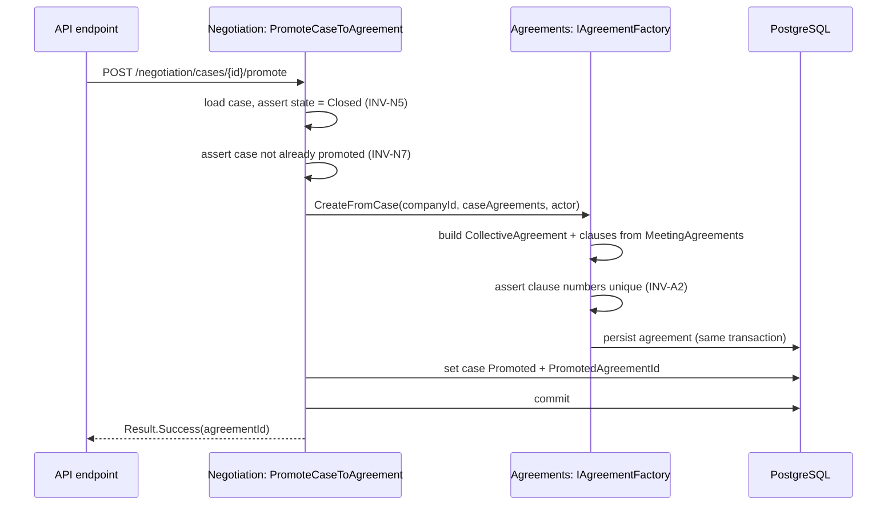

# Domain model — Convenciones

**Status: proposed for approval.** Domain decisions that need sign-off are marked **[A-nn]** and
collected in [decisions.md](decisions.md#decisions-requiring-approval).

Scope: [mvp-scope.md](mvp-scope.md). Persistence and layering: [solution-architecture.md](solution-architecture.md).

---

## 1. Where DDD earns its place — and where it does not

The instruction is to use DDD "where it provides real value", so this section is as much about the
exclusions as the inclusions.

### Aggregates are justified where an invariant spans several rows

| Aggregate | The invariant that forces it |
|---|---|
| `CollectiveAgreement` | *An agreement cannot be published without at least one clause*, and clause numbers must be unique **within** the agreement. Both require the whole clause set to be loaded and validated together. |
| `NegotiationCase` | *A case cannot be closed unless it has at least one agreement*, and a petition that produced an agreement cannot be edited. Both span case + petitions + agreements. |
| `Statute` | Article numbers unique within a statute; statute publication date cannot postdate its articles in a promotion scenario. |

### No aggregate — plain entities with application services

These are CRUD over reference or independent data. Wrapping them in aggregates with repositories and
domain events would be ceremony:

`Company` (address and contacts are data, not an invariant cluster), `Country`/`State`/`Municipality`,
`CompanySector`/`CompanyType`/`CompanyCategory`/`EconomicActivity`, `ComparisonHeading`/
`ComparisonHeadingGroup`, `NewsArticle`/`NewsCategory`, `Role`/`Capability`, `Document`.

`Company` deserves one note: it is *not* an aggregate boundary in the legacy system and has no
multi-entity invariant. It is a rich entity with owned value objects (address, contact, tax id) — not
an aggregate root with children.

### No domain events in the MVP

The only cross-aggregate side effect is auditing, handled uniformly by a persistence interceptor. A
domain-event dispatcher would raise a transactional-outbox question the MVP does not need to answer
(see [solution-architecture.md](solution-architecture.md) §8).

---

## 2. Ubiquitous language

Constitution Art. X: English identifiers, Spanish user-facing copy. The mapping is explicit because
several legacy names are misleading.

| Spanish (UI) | Model name | Legacy table | Note |
|---|---|---|---|
| Convención colectiva / contrato colectivo | `CollectiveAgreement` | `contratos` | |
| Cláusula / artículo | `AgreementClause` | `articulos_contratos` | "artículo" also means statute article — disambiguated by aggregate |
| Anexo | `AgreementAnnex` | `anexos_contratos` | |
| Empresa | `Company` | `empresas` | |
| Bitácora / discusión | `NegotiationCase` | `bitacoras` | Legacy name means "logbook"; it is a negotiation case |
| Petición (sindicato) | `UnionPetition` | `peticiones_sindicato` | |
| Oferta (patrono) | `EmployerOffer` | `ofertas_patrono` | |
| Reunión | `NegotiationMeeting` | `reuniones` | |
| Acuerdo | `MeetingAgreement` | `acuerdos` | An agreement *reached in a meeting*, not a collective agreement |
| Ley marco / LOTTT | `Statute` | `ley_trabajo`, `otras_leyes` | Two legacy tables folded into one |
| Artículo (de ley) | `StatuteArticle` | `articulos_ley_trabajo`, `articulos_otras_leyes` | |
| Título comparativo | `ComparisonHeading` | `titulos` | |
| Bloque de cláusulas | `ComparisonHeadingGroup` | `categorias_titulos` | |
| Campo comparativo | `EconomicComparisonNote` | `campo_comparativo` | Free text in MVP — see §2.6 |
| Estado de publicación | `PublicationState` | `status_publicacion` | |
| No compara | `ComparisonHeading.IsExcluded` | heading 62 | A heading, not a flag, in legacy |

`MeetingAgreement` vs `CollectiveAgreement` is the collision most likely to cause a bug. The model
keeps them clearly distinct; the UI copy must too (**"acuerdo de reunión"** vs **"convención"**).

### 2.1 State vocabularies (proposed)

| Enum | Values | Legacy equivalent |
|---|---|---|
| `PublicationState` | `Draft`, `Published` | `PE`/`Pe`/`PU` (three values for two states — DS-15) |
| `NegotiationCaseState` | `Draft`, `Open`, `Closed`, `Promoted` | `''`/`1`/`10` (ambiguous — Q-4) |
| `PetitionState` | `Open`, `Agreed`, `Rejected`, `Withdrawn` | `''`/`9` (Q-5) |
| `PartyRole` | `Employer`, `Union`, `LabourMinistry`, `Other` | three fixed column blocks |
| `NewsState` | `Draft`, `Published` | `'Pendiente'`/`'Publicar'` |
| `StatuteKind` | `LabourLaw`, `OtherStatute` | `ley_trabajo` vs `otras_leyes` (two tables) |

**[A-13]** `NegotiationCaseState` and `PetitionState` are proposals. The legacy data contains **no
case in the closed state and no petition in the agreed state**, so these values cannot be validated
against evidence — they are a design judgement about what a negotiation workflow needs.

### 2.2 Value objects

| Value object | Shape | Invariant |
|---|---|---|
| `ClauseNumber` | `int` | `>= 1`. **Q-2 removed the letter suffix**; T8 implements the number as a positive integer with no derived sort key |
| `DateRange` | `Start date`, `End date?` | `End >= Start` when present |
| `TaxId` (RIF/NIT) | `Prefix`, `Number`, `CheckDigit?` | Normalised; not validated against a registry |
| `EmailAddress` | string | RFC-compliant enough for contact data |
| `DocumentReference` | `DocumentId`, `FileName`, `ContentType` | Content type from an allow-list |
| `PersonName` | string | Non-empty; no further structure (legacy had none) |

`ClauseNumber` is the most consequential. Legacy stored `varchar(11)` and sorted lexicographically,
producing 1, 10, 100, 11, 2 (DS-23 / BR-02). **Decision Q-2 settled the question A-14 left open: the
number is a plain integer.** There is no suffix, and numeric ordering is what the column and the query
now produce.

### 2.3 Agreement identity (Q-1, superseding A-15)

**Decision Q-1:** identity is `(CompanyId, ValidFrom)`, with a unique constraint. The agreement has
**no stored `Title` and no `Number`**: the display title is composed on read from the company's current
name and the validity period. The A-15 proposal to store both was rejected after the drift risk was
seen in the legacy data.

Reasoning: the legacy table had **no** identity beyond its company, so two agreements for one company
were indistinguishable in every list and URL. A globally unique agreement number would be inventing a
registry that does not exist; uniqueness per company per start date matches how the data behaves (72
distinct companies, one company with two agreements).

### 2.4 Clause classification **[A-16]** (resolves Phase 1 Q-15)

**Proposal:** every clause **must** reference a `ComparisonHeading`; comparability is controlled by
`ComparisonHeading.IsExcluded`.

Legacy had two mechanisms for the same idea: a nullable heading (`0` = none, 899 clauses) and a
heading literally named "No Compara" (853 clauses). The data shows that a real editorial decision is
being recorded — *this clause is not comparable* — but it was recorded as data in the taxonomy rather
than as a property of the taxonomy.

Proposal: `IsExcluded` on the heading, and the comparison query filters `IsExcluded = false`.
Classification becomes mandatory (`NOT NULL`), which also eliminates the 16.6% unclassified backlog at
the root. If an "unclassified" state is genuinely needed, `[A-16]` should be rejected and the column
made nullable instead.

### 2.5 Clause exclusion from the compiled document **[A-17]** (resolves Phase 1 Q-19)

**Proposal:** `AgreementClause.IsExcludedFromCompilation bool`, default `false`, with an optional
`ExclusionNote`.

Legacy: `articulo_cerrado char(1)` read only by the print view (`impresion_clausulas.php:22`), holding
`'0'` (4,052), `'1'` (158) and `NULL` (1,192). The name means "closed article" but the behaviour is
"omit from the compiled document". The model names the behaviour. **The reason for exclusion is
unknown** — this is the one place where I am modelling a behaviour whose purpose I cannot explain, and
the field exists so the business can record its reason.

### 2.6 Economic comparison **[A-18]** (Phase 1 Q-3 — deferred, not resolved)

**Proposal for the MVP: `EconomicComparisonNote text` (free text), as legacy had.**

`categorias_titulos.requiere_campo_comparacion_economica` marks 4 of 5 heading blocks as requiring an
economic value, but **no code ever reads the value and no code enforces the flag** (BR-05). Phase 2
established the schema has no numeric type at all.

I deliberately do **not** model an amount + currency + unit, because that would be inventing domain
semantics: the legacy values are free text, and the domain meaning (monthly amount? percentage?
days?) is unknown. If economic comparison should be structured, that is a **new requirement** and
must be specified — it is possibly the highest-value feature in the product and the wrong choice here
would be expensive.

---

## 3. Aggregates

### 3.1 `CollectiveAgreement`

**Invariants**

| ID | Invariant | Where enforced |
|---|---|---|
| INV-A1 | `Validity.End >= Validity.Start` | `DateRange` constructor |
| INV-A2 | Clause numbers are positive integers, unique within the agreement | aggregate `AddClause`/`UpdateClause` + DB unique index |
| INV-A3 | Publishing requires ≥ 1 clause | `Publish()` |
| INV-A4 | Every clause references exactly one heading | `NOT NULL` FK |
| INV-A5 | `PublishedAt`/`PublishedBy` are set together, never partially | `Publish()`/`Unpublish()` + DB `CHECK` |
| INV-A6 | A published agreement's clauses may still be edited; the edit is audited | `UpdateClause` writes `AuditEntry` |
| INV-A7 | `(CompanyId, ValidFrom)` unique | DB unique index |

**INV-A6 is a deliberate product stance [A-19]:** legacy had no versioning, and blocking edits after
publication would be a new rule. The MVP allows the edit and records it, so drift is *visible* instead
of forbidden. If agreements must be frozen after publication, that changes to a versioned model —
a significantly larger design.

### 3.2 `NegotiationCase`

**Two legacy problems fixed structurally:**

- `bitacoras` stored three parties as 12 fixed columns (DS-27). `NegotiationParty` makes the party
  list a collection, so a fourth party or two employer representatives need no schema change.
- `acuerdos` carried four sibling pointers (case, petition, offer, meeting) with no agreement between
  them (DS-28). `MeetingAgreement` derives its case from its petition and names one meeting.
- The three junction tables collapse: a petition belongs to a case, and a meeting belongs to a case,
  so `MeetingAgreement` and the meeting's petition references express the linkage once.
  **[A-20]** Confirm that offers are always in response to exactly one petition (legacy had a nullable
  `codigo_peticion`, and 3 of 4 values were orphans).

**Invariants**

| ID | Invariant | Where enforced |
|---|---|---|
| INV-N1 | A case has at least one `Union` party and one `Employer` party before it can open | **not enforced** — see the note below |
| INV-N2 | Closing requires ≥ 1 `MeetingAgreement` | `Close()` + `api-contracts.md §2.1` |
| INV-N3 | A petition with state `Agreed` cannot be edited or deleted | `UpdatePetition`/`DeletePetition` |
| INV-N4 | The chain is `Open → InProgress → Pending → Agreed → Closed`; closing is only allowed from `Agreed` | state machine |
| INV-N5 | Promotion is a separate operation for a `Closed` case; it records the resulting agreement while the state stays `Closed` | `Promote()` + the database guard |
| INV-N6 | Reopening is allowed from `Closed` but **not** from a promoted case | state machine + the database guard |
| INV-N7 | Promotion is idempotent — a second attempt is rejected, not duplicated | `Promote()` + the database guard and the unique index on `PromotedAgreementId` |

INV-N7 answers the legacy defect where reopening and re-closing duplicated every clause into a second
agreement (BR-11). INV-N6 is the decision that promotion is final **[A-21]**.

**INV-N1 is not enforceable in the implemented lifecycle.** Q-4 (T11 D2) removed `Draft`, so a case is
created directly in `Open`: nothing precedes the state in which the parties would be required. Enforcing
the invariant at creation would be a new business rule, and T11 was authorised on the opposite principle
(no invented preconditions). It stays unimplemented until a decision is recorded — the options are a
pre-open state, a party requirement on creation, or dropping the invariant.

**INV-N2's provenance.** The "at least one meeting agreement before closing" rule comes from the API
contract (which lists "close without agreements" among the `invalid_state` refusals) and from this
invariant. The legacy application only computed the message "No Existen Acuerdos en este Contrato" in
the UI; it never refused the write server-side. The rule is implemented, with that distinction recorded
in ADR-025.

### 3.3 `Statute`

Folding `ley_trabajo` and `otras_leyes` into one `Statute` with a `Kind` removes the legacy "table
with no primary key" problem and gives labour-law articles the FK they never had (DS-03). The
`ArticleCount` is **computed**, not stored (DS-29).

**At most one `LabourLaw` statute may exist.** The rule spans rows, so no aggregate can evaluate it:
the partial unique index `statute_single_labour_law_key` is the guard, and the API translates its
refusal into a 409 that names it. `Kind` is fixed at creation for the same reason (T10).

`StatuteArticle.HeadingId` is **nullable [A-12]**, unlike `AgreementClause.HeadingId`: 89.6% of
other-statute articles were unclassified, so requiring classification would block loading the library
at all. The article's own heading — `StatuteArticle.Title` — is **mandatory**: an article with no
heading cannot be cited.

### 3.4 `Company`

An entity with owned value objects — **not** an aggregate root with children, because no invariant
spans its parts:

`Id`, `Name` (required), `LegalName?`, `TaxId` (RIF/NIT, optional), `Address` (owned: street, city,
state, country, postal code) replaced the three loose `codigo_pais`/`codigo_estado`/`codigo_localidad`
columns (DS-13), `Contact` (owned: name, position, phones, email), `Classification` (sector, type,
category, activity), `EmployeeCounts` (workers, employees, size band), `LogoDocumentId?`,
`LegacyCode?` (resolves Q-18 — see [decisions.md](decisions.md) ADR-018).

**The single-identity decision:** `Id` is the only key. If the legacy `codigo_empresa` matters to the
business it survives as `LegacyCode` — a unique-when-present attribute, never a join key. Phase 2
proved the two legacy identities are used inconsistently in the same data.

### 3.5 `ComparisonHeading` / `ComparisonHeadingGroup`

Small aggregate: `ComparisonHeadingGroup(Name, Description, RequiresEconomicComparison, SortOrder)` with
`ComparisonHeading(Name, Description, IsExcluded, SortOrder)` as children. Invariant: `Name` unique
within group; each heading belongs to exactly one group; changing `RequiresEconomicComparison` does not
retroactively invalidate clauses (it is advisory in the MVP, since legacy never enforced it — BR-05).

`SortOrder` replaces nothing — legacy ordered headings alphabetically by name, and the 5 category
blocks are a meaningful sequence (GENERALES → ECONÓMICO → SOCIOECONÓMICAS → SINDICALES → SEGURIDAD
OCUPACIONAL) **[A-22]**.

### 3.6 Platform entities

| Entity | Shape | Note |
|---|---|---|
| `UserAccount` | `Id` (mirrors Supabase `sub`), `Email`, `IsBlocked`, `ExpiresOn?`, `LastSeenAt?` | Credentials live in Supabase Auth, not here (DS-31) |
| `UserProfile` | `DisplayName`, `Phone?`, `CompanyId?` | Company link reproduces the legacy soft tenancy scope |
| `Role` | `Id`, `Name`, `Description`, `IsSystem` | `IsSystem` protects the SuperAdmin role |
| `Capability` | `Id`, `Key` (e.g. `agreement.publish`), `Description` | Replaces filename-keyed screens (DS-20) |
| `RoleCapability` | `(RoleId, CapabilityId)` unique | Legacy had no uniqueness (DS-04) |
| `Document` | `Id`, `StoragePath`, `FileName`, `ContentType`, `SizeBytes`, `UploadedBy`, `UploadedAt`, `ExtractionStatus` | §7 of solution architecture |
| `AuditEntry` | `Id`, `OccurredAt`, `ActorId`, `Module`, `EntityType`, `EntityId`, `Action`, `Changes jsonb` | Replaces the login log that never existed (DS-32) |
| `NewsArticle` | `Id`, `Title`, `Summary`, `Body`, `State`, `PublishedAt?`, `PublishedBy?`, `CategoryId` | Images stay out of the MVP: a public image needs a document download route (ADR-026) |

---

### 3.7 `NewsArticle` / `NewsCategory`

| ID | Invariant | Where enforced |
|---|---|---|
| INV-P1 | An article is `Published` if and only if `published_at` and `published_by` are set | database CHECK + `app.guard_news_publication()` |
| INV-P2 | An article is created as `Draft`; only the publish operation changes the state, and it requires `news.publish` | `NewsArticle.Create`/`Publish` + the database guard |
| INV-P3 | `published_by` and `published_at` are the database's values, never the caller's | `app.guard_news_publication()` assigns them |
| INV-P4 | The body is sanitised rich text (A-33) | `RichText.Clean` on write, `RichText.Sanitize` again in the public projection |
| INV-P5 | A category name is unique case-insensitively | `news_category_name_key` |

`NewsCategory` is reference data: global, no company, read by the portal and written by administrators
through `POST /news/categories` (no legacy category rows were migrated).
## 4. Application services (use-case catalogue)

Each is a class with one public method returning `Result<T>`. No mediator, no dispatcher — endpoints
call them directly (see [solution-architecture.md](solution-architecture.md) §8).

### Agreements

| Service | Method | Invariants touched |
|---|---|---|
| `CreateAgreement` | `Handle(CompanyId, DateRange, Scope, actor)` | INV-A1, INV-A7 |
| `UpdateAgreementHeader` | `Handle(AgreementId, …)` | INV-A1 |
| `AddClause` | `Handle(AgreementId, int number, Title, Summary?, Body, HeadingId, actor)` | INV-A2, INV-A4 |
| `UpdateClause` | `Handle(AgreementId, ClauseId, …)` | INV-A2, INV-A4, INV-A6 |
| `RemoveClause` | `Handle(AgreementId, ClauseId, actor)` | INV-A2 |
| `ReclassifyClause` | `Handle(AgreementId, ClauseId, HeadingId, actor)` | INV-A4 |
| `PublishAgreement` | `Handle(AgreementId, actor, now)` | INV-A3, INV-A5 |
| `UnpublishAgreement` | `Handle(AgreementId, actor, now)` | INV-A5 |
| `AddAnnex` / `UpdateAnnex` / `RemoveAnnex` | | |
| `GetAgreement` | read | |
| `ListAgreements` | read, paged, filtered by company/state | |

### Negotiation

`CreateCase`, `AddParty`, `RemoveParty`, `OpenCase`, `RecordPetition`, `UpdatePetition`,
`RecordOffer`, `RecordMeeting`, `RecordMeetingAgreement`, `CloseCase`, `ReopenCase`,
`PromoteCaseToAgreement`, `GetCase`, `ListCases`.

`PromoteCaseToAgreement` is the cross-module case: it calls `IAgreementFactory` (implemented by
Agreements) inside **one transaction**, then marks the case `Promoted`.

### LegalLibrary

`CreateStatute`, `UpdateStatute`, `AddArticle`, `UpdateArticle`, `RemoveArticle`, `GetStatute`,
`ListStatutes`, `ListArticles`.

### Comparison

`GetComparison(headingId, agreementIds[])` — the single read that defines the product. Returns clause
columns per agreement plus statute articles for the heading. Never writes.

### Catalog

`CreateCompany`, `UpdateCompany`, `ArchiveCompany`, `GetCompany`, `ListCompanies`, plus catalogue CRUD
and reference-data reads.

### Identity

`RegisterFirstSuperAdmin` (one-time bootstrap, Art. VI.6), `InviteUser`, `UpdateUser`,
`BlockUser`, `AssignRole`, `ListCapabilities`.

### Publishing

`CreateNews`, `PublishNews`, `UnpublishNews`, `ListPublishedAgreements` (public projection),
`GetPublishedAgreement` (public projection).

---

## 5. State machines

### 5.1 `NegotiationCase`

```mermaid
stateDiagram-v2
    [*] --> Open: Create() · Open is the initial state (Q-4, no Draft)
    Open --> InProgress: StartInProgress()
    InProgress --> Pending: MarkPending()
    Pending --> InProgress: StartInProgress()
    Pending --> Agreed: Agree() · explicit, no invented precondition
    Agreed --> Closed: Close() · requires ≥1 meeting agreement (INV-N2)
    Closed --> InProgress: Reopen() · audited, clears closed_at
    Closed --> Closed: Promote() · separate, authorised, atomic; records promoted_agreement_id
    note right of Closed
        A promoted case is terminal: the link cannot be cleared,
        so it cannot be reopened (A-21, ADR-014). Established by
        app.guard_case_promotion(), not only by the aggregate.
    end note
```

### 5.2 `CollectiveAgreement` publication

### 5.3 `UnionPetition`

**Rejected / Withdrawn are proposals [A-13]** — legacy could express neither.

---

### 5.4 `NewsArticle` publication

Publication is the only transition, it is guarded by `news.publish` in the API **and** by
`app.guard_news_publication()` in the database, and an article cannot be inserted already published.
Unpublishing keeps the row and its edit history; only the state and the publication columns change.
## 6. Cross-module contract: promotion

The one place where two aggregates from different modules must change together.

`IAgreementFactory` is declared in `Negotiation`'s application layer and implemented in `Agreements`,
resolved at the composition root — so the compile-time dependency stays one-directional
([solution-architecture.md](solution-architecture.md) §3.4, rule 5).

**The transaction spans both modules because they share one `DbContext`** — the concrete justification
for ADR-007.

---

## 7. Acceptance criteria — domain layer

Verifiable by unit tests, independent of the database:

| ID | Criterion |
|---|---|
| **AC-D1** | `DateRange` rejects `End < Start` and accepts `End == Start` |
| **AC-D2** | Adding a clause with a duplicate `ClauseNumber` in the same agreement throws `DomainRuleViolated` |
| **AC-D3** | Clause ordering is numeric: inserting `1, 10, 2, 100` lists `1, 2, 10, 100` |
| **AC-D4** | `Publish()` on an agreement with zero clauses fails with `AgreementHasNoClauses` |
| **AC-D5** | `Publish()` sets `State`, `PublishedAt` and `PublishedBy` together; `Unpublish()` clears all three |
| **AC-D6** | `Close()` on a case with no `MeetingAgreement` fails |
| **AC-D7** | *(not enforced — INV-N1 needs a decision; a case is created in `Open`)* |
| **AC-D8** | A petition in `Agreed` state rejects `UpdatePetition` |
| **AC-D9** | `Promote()` twice returns a conflict and creates no second agreement |
| **AC-D10** | `Reopen()` on a promoted case fails (state `Closed`, link set) |
| **AC-D11** | `ClauseNumber` parses `"12"`, `"012"`, `"12-A"` to the same numeric order as `12`, and rejects `"5 555"` |
| **AC-D12** | The comparison projection excludes headings where `IsExcluded = true` |
| **AC-D13** | A `Company` can hold a `LegacyCode` that is unique-when-present, and two companies cannot share one |
