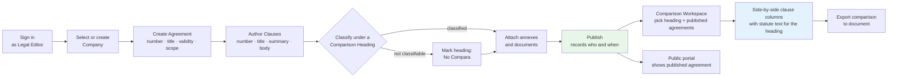
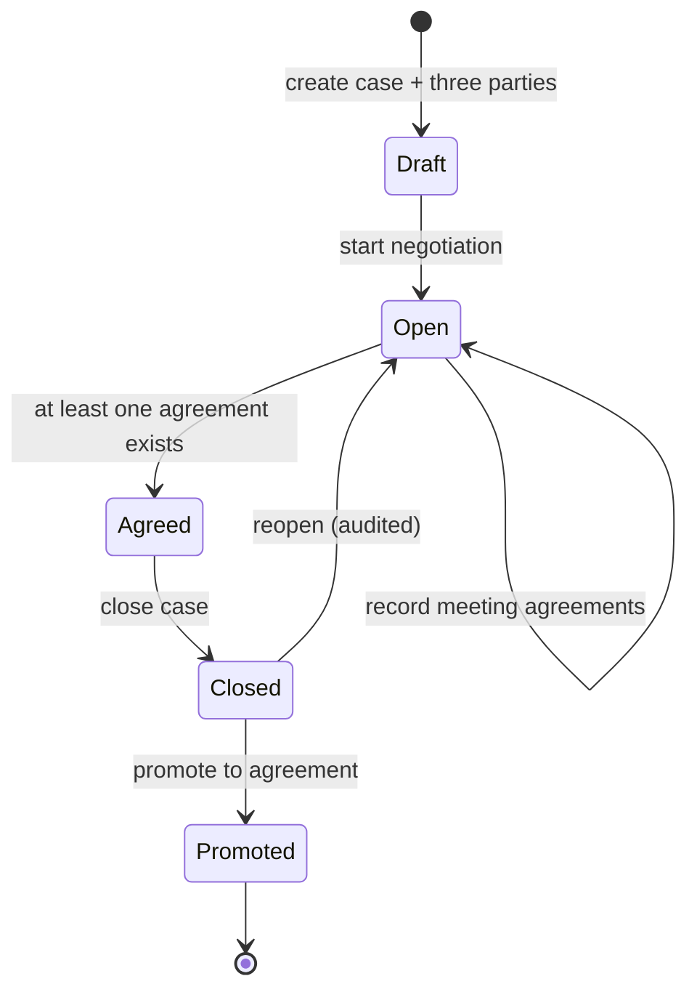

# MVP scope — Convenciones

**Status: proposed for approval.** Every decision marked **[A-nn]** requires Product Owner sign-off;
they are collected in [decisions.md](decisions.md#decisions-requiring-approval).

Derived exclusively from the approved Phase 1 findings
([../legacy/](../legacy/)) and Phase 2 findings ([../database/](../database/)). Where the legacy
system provides no evidence for a choice, that is stated rather than invented.

---

## 1. The problem

A collective bargaining agreement (*convención colectiva*) is a long legal document consisting of
dozens to hundreds of numbered clauses. In the legacy data, **73 agreements contain 5,402 clauses —
about 74 per agreement**. The work that the business actually performed at that scale was:

1. **Transcribing** negotiated text into a structured, numbered clause list.
2. **Classifying** each clause under a shared comparison heading so equivalent clauses from different
   agreements can be read side by side.
3. **Comparing** those clauses — against other agreements by the same or other companies, and against
   the labour statute and other statutes.

The legacy system did all three, and its data proves they were used: **83.4% of clauses carry a
comparison heading**, 63 of 64 defined headings are in use, and the comparison screen was reachable
from the main navigation.

What it could not do — and why a rebuild is warranted rather than a repair:

| Legacy limitation | Evidence |
|---|---|
| Comparison only *placed* clauses side by side; it never aligned, matched or diffed them | Phase 1 §BR-15 |
| No search over clause text; every query is a full table scan | Phase 2 DS-05 |
| A published agreement's clauses could silently drift (`status_articulo` never written) | Phase 2 DS-18 |
| Clause exclusion from the published document was a hidden print-time filter | Phase 1 §BR-07C |
| Nothing recorded who changed what | Phase 2 DS-30 |
| 16.6% of clauses and 89.6% of statute articles were unclassified, with no way to find them | Phase 2 §G |

**The MVP solves the classification-and-comparison problem well**, and stops there. It does not
attempt the two things the legacy system only pretended to do: aligned clause diffing, and automatic
extraction from PDFs.

## 2. Target users

Grounded in the six legacy roles and their grant counts (Phase 1 §BR-19), which describe *work
functions* for the first three and *feature bundles* for the last three.

| Persona | Legacy evidence | What they need from the MVP |
|---|---|---|
| **Legal editor / transcriber** | `Transcriptor`, 45 grants — the most privileged non-admin role | Create agreements, author and classify clauses, attach annexes, publish |
| **Analyst / comparer** | `Perfil 2` and `Perfil 3` profiles (18 and 49 grants) — defined by *which features* they cover, including comparison and negotiation | Read everything, run comparisons, export results |
| **Negotiator** | `Perfil 3` includes the negotiation module | Run cases: parties, petitions, offers, meetings, agreements |
| **Administrator** | `Master`, bypassed every check | Manage users, roles, capabilities, catalogues, reference data |
| **Public reader** | Static `index.html` portal, unreachable dynamic news front-end | Read published agreements and news, no account |

**[A-01] These five personas must be confirmed or corrected.** The legacy roles contradict their own
names (the "Transcriptor" holds delete rights on companies and statutes; the "Operador" holds six
read-only grants), so the personae above are my reading of the *work*, not a renaming of the roles.

## 3. The primary workflow (the demonstration spine)

> **W1 — Agreement intake to published comparison.**

Everything in the MVP exists to make this one journey work end to end and be demonstrable in a
single session against a fresh database.

**Why this workflow and not negotiation.** It is the only one with production-scale evidence: 73
agreements and 5,402 clauses, versus 2 negotiation cases, 9 petitions and **1 agreement** in the
entire dump. The negotiation module is exercised at token scale, so it cannot be the spine of a
demonstration that proves the product works.

**[A-02] Negotiation remains in MVP scope** (your decision in Task 1), but as a **separate slice
after** the spine — not part of the demonstrable core. See §5 for the alternative.

### W1 acceptance criteria (end to end)

| ID | Criterion | Verification |
|---|---|---|
| **AC-W1.1** | A user with the editor capability can sign in and reach the agreement list | Automated UI test; manual check |
| **AC-W1.2** | An agreement can be created with number, title, company, validity range and scope, and appears in the list | API + UI test |
| **AC-W1.3** | Clauses can be added with a number, title, summary and body, and are listed in **numeric** clause order (1, 2, 10, 11 — not 1, 10, 11, 2) | Integration test asserting order with clauses `1, 2, 10, 100` |
| **AC-W1.4** | Every clause must be assigned either a comparison heading or the explicit *No Compara* heading; submission without either is rejected with a field-level error | Validation test |
| **AC-W1.5** | Publishing an agreement records `published_at` and `published_by` and makes it visible to the public portal; unpublishing reverses both | Integration test on audit fields |
| **AC-W1.6** | The comparison workspace, given one heading and two published agreements, renders one column per agreement listing that agreement's clauses for the heading, in clause order | UI test with fixture data |
| **AC-W1.7** | The comparison workspace shows the statute article(s) for the same heading alongside the agreement columns | UI test |
| **AC-W1.8** | An unpublished agreement cannot be selected for comparison, even by calling the API directly with its id | API test returning 404/409 |
| **AC-W1.9** | The whole W1 sequence is executable against a database containing only seed reference data, in under 5 minutes of manual work | Manual demo script |

---

## 4. Feature classification

Grounded in the Phase 1 feature table (34 features) and Phase 2 data evidence. Only features with a
named requirement appear in MVP.

### 4.1 MVP — required, in scope

| # | Feature | Legacy origin | Why in MVP |
|---|---|---|---|
| F-01 | Authentication and session | Phase 1 §F1 | Everything depends on identity; legacy had none that worked |
| F-02 | User, role and capability administration | §BR-18/19 | Roles must be redefined, not renamed |
| F-03 | Company registry (with address and classification) | §BR-23 | Agreements are identified by company |
| F-04 | Reference data: countries, states, municipalities | §BR-22 | Company addresses need them |
| F-05 | Business catalogues: sector, type, category, activity | §3.6 inventory | Classification of companies |
| F-06 | Comparison taxonomy: heading groups + headings | §BR-04/05 | The classification backbone of the product |
| F-07 | Agreement CRUD with validity and scope | §BR-01 | Core aggregate |
| F-08 | Clause authoring with heading classification | §BR-02/03/04 | Core value |
| F-09 | Agreement annexes | §BR-07 | Real, 29 in legacy |
| F-10 | Publish / unpublish with actor and timestamp | §BR-06 | Gates comparison and the portal |
| F-11 | Comparison workspace (adjacency) | §BR-15 | The product's purpose |
| F-12 | Legal library: statutes and articles | decided Task 1 | Comparison reads statute text |
| F-13 | Document storage for **PDF documents only** — every other format is rejected with 415 | §S7, DS-11 | Annexes, acts and statute documents are PDFs; the platform parses them instead of trusting a declared type |
| F-14 | Audit trail | §S14, DS-30 | New requirement, not a port |
| F-15 | Negotiation case lifecycle | §BR-08…14 | In scope by your decision |
| F-16 | Public portal: published agreements + news | decided Task 1 | Publication must have a consumer |
| F-17 | Responsive layout, keyboard-accessible forms | — | Table stakes; not a legacy feature |

### 4.2 Next release (R2) — confirmed real, deliberately deferred

| # | Feature | Why not MVP |
|---|---|---|
| R2-01 | **Clause alignment** — pair equivalent clauses across agreements, flag silence | Depends on Q-6; a new capability, not a port. Largest single risk in the project |
| R2-02 | Clause-level full-text search | Legacy had none (`LIKE '%…%'` scans); value is obvious but W1 does not need it |
| R2-03 | Negotiation history and print | Legacy was buggy (`historico.php:233` prints the wrong field) |
| R2-04 | Comparison document export | Legacy PDF path was unreachable; W1 exports via browser print first |
| R2-05 | "Unclassified clauses" worklist | 899 clauses and 2,672 statute articles are unclassified; a worklist makes the backlog tractable |
| R2-06 | "No Compara" bulk classification | Currently 853 clauses sit under it; bulk reclassification is a later convenience |
| R2-07 | Bulk import from a clause spreadsheet | Not in legacy at all; would help onboarding |

### 4.3 Future — stated, not scheduled

| # | Capability | Why future |
|---|---|---|
| FUT-01 | **Automated clause extraction from PDFs** | Objectives §9 ask for the design seam. Legacy had manual transcription only |
| FUT-02 | **AI-assisted clause classification** (suggest a heading) | Genuinely valuable — 16.6% of clauses are unclassified — but needs a labelled dataset the MVP does not yet produce |
| FUT-03 | AI-assisted clause summarisation | Summaries exist in legacy but were human-written |
| FUT-04 | Aligned clause diffing beyond pairing (semantic similarity) | Requires R2-01 first |
| FUT-05 | Links of interest | Phase 1 Q-16: no requirement exists |
| FUT-06 | Multi-company tenancy | Legacy has no tenancy dimension; see security-model |

### 4.4 Explicitly **not** built (legacy behaviors rejected)

| Rejected | Reason |
|---|---|
| `status_articulo` editorial workflow | 5,402 rows, one value, zero writers (DS-18) |
| `estatu_pase_contratos` handoff flag | Read by dead JavaScript, written by nothing (DS-18) |
| Annex publication state | 29 of 29 `'Pendiente'`, never read (DS-16) |
| Stored article counters | Derived; compute instead (DS-29) |
| Login audit into a nonexistent table | `usuarios_login` never existed (DS-32) |
| Filename-keyed permissions | No analogue in a SPA (DS-20) |
| Bulletins and documents repository screens | Unreachable in legacy (inventory §6) |
| Static header login box | Non-functional (Phase 1 §F1) |

---

## 5. The scope decision I need you to make

**[A-02] Negotiation in MVP or R2?**

| Option | MVP content | Tradeoff |
|---|---|---|
| **A (recommended)** — negotiation in MVP as a *thin* slice: case, parties, petitions, offers, meetings, agreements, close→promote, reopen | ~15% more MVP work | Honours your Task 1 decision; but the legacy data (2 cases, 1 agreement) gives almost no behavioral evidence to validate against, so we will be designing from code reading alone |
| **B** — negotiation deferred to R2; MVP is the agreement→comparison spine only | ~15% less MVP work, earlier demo | Delivers the demonstrated value sooner; contradicts the Task 1 decision unless you change it |

My recommendation is **A**, because you already approved it and because W2 shares the Agreement
aggregate with W1 — the incremental cost is smaller than a later standalone build. But B is defensible
on evidence grounds, and if you prefer a smaller first release it should be an explicit decision, not
a drift.

---

## 6. Secondary workflow W2 (in MVP under option A)

> **Negotiation case to agreement.**

**The state names above are a proposal [A-03]**, because the legacy three states are ambiguous:
`''` (never written), `1` (written only by *reopen*), `10` (closed). The legacy UI labels `1` as
"Modificación", which reads as "under modification" but is produced by reopening. There is no
evidence any case ever reached `10`.

Acceptance criteria for W2 are in §7 of [domain-model.md](domain-model.md), where the state machine
and its invariants are defined.

---

## 7. Out of scope for the MVP

Stated so absence is a decision:

- Any data migration from MySQL (constitution Art. V.2). The legacy dump informs the *model* only.
- Multi-tenant operation. Single organisation per deployment **[A-04]**.
- Mobile applications, offline mode, native clients.
- Email or push notifications (none existed in legacy; none required yet).
- Background job processing and message brokers (see [solution-architecture.md](solution-architecture.md) §7).
- Clause alignment and diffing (R2).
- PDF text extraction and any AI capability (FUT).
- Full-text search (R2).
- Reporting or analytics dashboards beyond the comparison workspace.
- Localisation beyond Spanish UI copy with English identifiers (constitution Art. X).

---

## 8. Definition of done for the MVP

The MVP is complete when all of the following hold, verifiably:

1. Every acceptance criterion in this document passes in CI.
2. The W1 demonstration runs from an empty database (reference seed only) to a rendered comparison in
   one session.
3. Every mutating endpoint has an integration test proving it rejects an unauthorised caller.
4. Every business table has audit columns populated by the API, and the audit log records state
   changes.
5. The application is orchestrated by .NET Aspire locally with one command.
6. No legacy credential, plaintext password, or `'0000-00-00'`-style sentinel exists anywhere in the
   codebase or schema.
7. Constitution Art. VII.1 holds: the CI report reflects tests actually executed.
