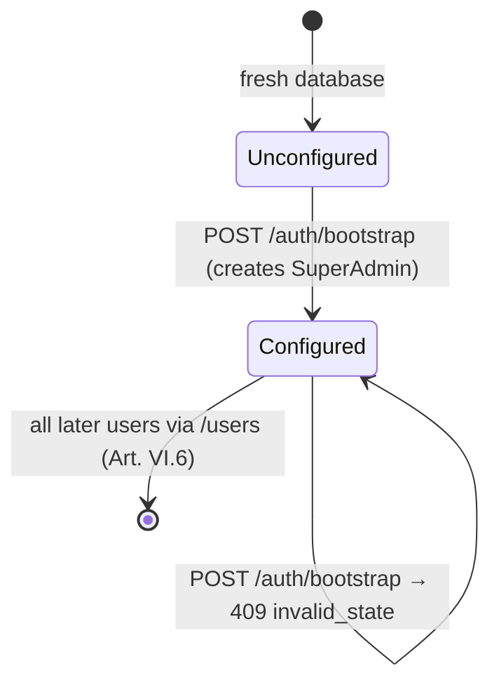
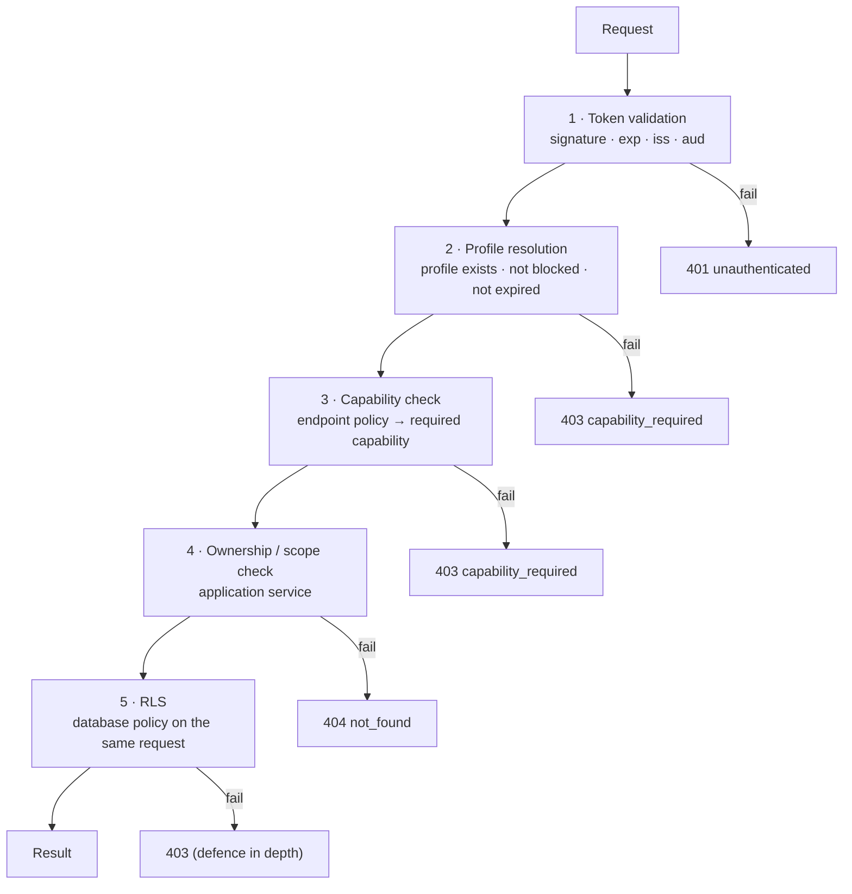

# Security model — Convenciones

**Status: proposed for approval.** Choices needing sign-off are **[A-nn]**, listed in
[decisions.md](decisions.md#decisions-requiring-approval).

This document answers: who the caller is, what they may do, what is recorded, and how the legacy
system's documented security failures are designed out rather than patched.

Legacy references: [../legacy/security-findings.md](../legacy/security-findings.md) (§S1–S15).

---

## 1. What the legacy system did wrong, and the structural answer

Each legacy failure has a design response, not a mitigation:

| Legacy failure | Structural answer here |
|---|---|
| §S2 — authentication bypassed by hardcoded bootstrap (`$nombreses = "Alex"`, `$t_usuario = 1`) | No hardcoded identity anywhere; the only privileged bootstrap is a one-time, inert-after-use endpoint (§2.3) |
| §S3 — plaintext passwords compared with `LIKE` | Credentials never touch our database; Supabase Auth hashes them (§2.1) |
| §S5 — 43 permission checks, 32 of them on read screens; 1 of 55 write screens | Capability checks on **every** endpoint by policy, verified by a test that enumerates all endpoints (§3.4) |
| §S4 — SQL built by string concatenation; "quoting" helper escaping only `'` | EF Core parameterises everything; **no raw SQL** outside migrations and reviewed read projections (§5.1) |
| §S7 — uploads named by the client, typed by the client MIME, `chmod 0777`, web-served | Private bucket, server-sniffed content type, generated storage keys, signed short-lived downloads (§6) |
| §S8 — rich text stored and re-emitted raw, zero `htmlspecialchars` | Server-side allow-list sanitisation on write (§5.2) |
| §S9 — destructive actions over GET, no CSRF protection | Bearer tokens (not cookies) and no `GET` mutations, so CSRF has no vector (§5.3) |
| §S10 — no session regeneration, no cookie flags | Tokens, not server sessions; short-lived access tokens with refresh (§2.2) |
| §S11 — expiry computed by hand in one view | Expiry is a capability-level predicate enforced per request (§4.3) |
| §S14 — audit log written to a table that never existed | Real `audit_entries` table, written in the same transaction (§7) |

---

## 2. Authentication

### 2.1 Delegation to Supabase Auth

Identity is **Supabase Auth (GoTrue)**. The application stores **no password, no hash, no salt, no
reset token**. This is mandated (Art. III) and it also deletes the entire class of defect the legacy
system had: `Clave_usuario varchar(20)` holding plaintext (DS-31).

`identity_users` in our schema is a **profile and authorisation record**, keyed by the Supabase `sub`
claim. It exists because authorisation needs roles, capabilities, blocking and expiry — none of which
Supabase Auth models.

```mermaid
sequenceDiagram
    actor U as User
    participant S as SPA
    participant SA as Supabase Auth
    participant API as API
    participant DB as PostgreSQL

    U->>S: email + password
    S->>SA: signInWithPassword
    SA-->>S: access_token (1 h) + refresh_token
    S->>API: GET /me  · Authorization: Bearer <access_token>
    API->>API: validate JWT signature (JWKS, cached) · exp · iss · aud
    API->>DB: SET LOCAL request.jwt.claims = '<claims>'
    API->>DB: SELECT profile + roles + capabilities for sub
    DB-->>API: rows (RLS applied)
    API-->>S: user · roles · effective capabilities
    S->>S: hold token in memory; schedule refresh
```

### 2.2 Token handling in the SPA **[A-34]**

Recommended: **access token in memory only**, `refresh_token` in a `HttpOnly; Secure; SameSite=Strict`
cookie managed by Supabase's client, access token never persisted to `localStorage`.

Tradeoff: a page reload loses the in-memory token and requires a silent refresh (one extra round-trip,
sub-100 ms locally). That is the correct trade for a system whose domain is legal documents. If you
prefer reload resilience over that hardening, the alternative is `sessionStorage`, which exposes the
token to any XSS — the very risk §5.2 exists to remove.

### 2.3 The bootstrap SuperAdmin (constitution Art. VI.6)

A fresh deployment must produce exactly one privileged account. Design:

| Requirement (Art. VI.6) | Implementation |
|---|---|
| Exactly one SuperAdmin, created outside the app | `POST /auth/bootstrap`, guarded by "no user with the `system.superadmin` role exists" |
| No default, hard-coded, or committed credential | The caller supplies email + password at setup time; nothing is seeded; no default account exists in any migration |
| Idempotent | A second call returns `409 invalid_state`; it never creates a second account or overwrites the first |
| Inert once a SuperAdmin exists | The endpoint checks existence **before** any write, inside a serialisable transaction, so concurrent calls cannot both succeed |
| No other out-of-band accounts | There is no seeding of users anywhere — not in migrations, not in the reference-data seed, not in tests against a real environment |



**The one gap I cannot close from the repository:** whether Supabase Auth's own sign-up endpoint should
be disabled. If public sign-up is enabled on the Supabase project, anyone can create an *authenticated*
account — harmless (they get no roles and every endpoint returns `403`), but it is attack surface and it
makes "no out-of-band accounts" untrue at the identity layer. **[A-35]** Confirm sign-ups are disabled
on the Supabase project; if they must stay open, the API must reject tokens for `sub`s without a
provisioned profile, which it does by default (no profile ⇒ `403 capability_required`).

---

## 3. Authorization

### 3.1 Model

**Capabilities**, not screens, not roles-as-checks.

```
UserAccount ──(1..*)── UserRoleAssignment ──> Role ──(1..*)── RoleCapability ──> Capability
```

Capability keys are `resource.action`:

`company.read`, `company.write`, `agreement.read`, `agreement.write`, `agreement.publish`,
`negotiation.read`, `negotiation.write`, `negotiation.promote`, `comparison.read`,
`statute.read`, `statute.write`, `news.read`, `news.write`, `news.publish`,
`catalog.read`, `catalog.write`, `document.read`, `document.write`,
`user.manage`, `role.manage`, `audit.read`, `system.superadmin`.

**Why not the legacy model.** Legacy granted access per *PHP filename*
(`pantallas.url_pantalla = 'tbl_paises_list.php'`, §S5 / DS-20). A React SPA has no filenames, so the
model cannot be translated — it must be replaced. Capability keys also make the grant matrix readable
and testable.

### 3.2 Roles **[A-36]** (resolves Phase 1 Q-9)

The legacy six roles mix work functions with feature bundles and contradict their names: `Transcriptor`
held 45 grants including delete on companies while `Operador` held 6.

Proposed four roles, defined by *work*:

| Role | Capabilities | Persona |
|---|---|---|
| **Administrator** | everything except `system.superadmin` | Runs the system |
| **Editor** | read everything; `agreement.write`, `agreement.publish`, `statute.write`, `company.write`, `news.write`, `document.*` | Authors and publishes |
| **Analyst** | read only: `agreement.read`, `comparison.read`, `statute.read`, `negotiation.read`, `news.read` | Compares and reports |
| **Negotiator** | `negotiation.read`, `negotiation.write`, `negotiation.promote`, plus read on agreements/statutes/comparison | Runs cases |

`system.superadmin` is a distinct capability granted only to the bootstrap account and to anyone it
promotes; it bypasses capability checks but **not** audit, not ownership checks, and not RLS.

There is **no implicit superuser**. The legacy system exempted type `1` from every check
(`if ($t_usuario != 1)`), which is precisely how one hardcoded flag disabled the whole model.

### 3.3 Enforcement layers



Layers 1–3 are **mandatory and uniform**: an endpoint is registered with its required capability, and
a filter enforces it. There is no way to add an endpoint without declaring one — a missing declaration
fails startup, not a request. This is the structural answer to §S5, where 54 of 55 write endpoints
simply had no check.

Layer 4 covers row scope: "can *this* user modify *this* agreement". In the MVP the only scoping is
company-level for negotiators (reproducing the legacy soft tenancy, Phase 2 §7) **[A-37]**.

**[A-32] How RLS is actually made effective.** Supabase RLS is enforced against the *database role and
JWT claims of the connection*, so an API that connects as a privileged role would bypass every policy —
RLS would be theatre. The design therefore has the API connect as a dedicated non-bypass role and, per
request, run `SET LOCAL request.jwt.claims = '<validated claims>'` so that `auth.uid()` resolves inside
policies. The cost is one `SET LOCAL` per request and a stricter connection setup; the benefit is that a
missing capability check in application code is still stopped by the database. If you consider that
complexity unwarranted for a single-tenant MVP, the alternative is to rely on layers 1–4 alone and treat
RLS as future work — but then the constitution's RLS mandate is nominal, and that should be an explicit
decision rather than an omission.

### 3.4 The test that prevents regression

An integration test enumerates **every** endpoint from the API's own route table and asserts, for each
one: unauthenticated → `401`; authenticated without the capability → `403`. An endpoint that cannot be
enumerated fails the test. This is the mechanism that makes "authorization is not decorative" checkable
in CI rather than a promise in a document.

---

## 4. Accounts: blocking, expiry, deactivation

| State | Field | Enforced |
|---|---|---|
| Blocked | `is_blocked` | Every request (legacy enforced it only at login, §S11) |
| Expired | `expires_on < today` | Every request |
| No profile | absence of `identity_users` row | Every request (provisioning is explicit, never automatic) |

**[A-38] Account expiry semantics are unproven.** Legacy had `fech_venc date` and a hand-rolled,
fatally broken 60-line check in one view (§S11 / BR-21). No legacy row has a future expiry, so the
intent cannot be validated. The proposal keeps a nullable `expires_on` enforced per request, with no
warning emails and no self-service renewal, because nothing supports more.

---

## 5. Application-layer controls

### 5.1 Injection

All data access is EF Core LINQ. Rules:

1. **No string-concatenated SQL.** Any `FromSql`/`ExecuteSql` requires a review comment explaining why
   LINQ cannot express it and must use parameters.
2. **No dynamic `ORDER BY` from request strings.** Sorting is an explicit allow-list mapping a known
   field name to an expression (§6 of api-contracts) — the legacy `ORDER BY emp.<input>` was an
   injection vector.
3. **Npgsql logging of parameter values disabled** outside local development, so personal data does not
   reach logs.

### 5.2 Cross-site scripting

Clause bodies, annex text and news bodies are legitimate rich text. Escaping them on output would
destroy the product; storing them raw is what the legacy system did (§S8).

Decision **[A-33]**: **sanitise on write, server-side, with an allow-list** (formatting tags only; no
`script`, `style`, `iframe`, `object`, event attributes, or `javascript:`/`data:` URLs). On read,
content is inserted into the DOM as sanitised HTML.

Implementation: a maintained sanitiser library (e.g. `HtmlSanitizer`/Ganss.Xss for .NET) rather than a
hand-rolled one. **Justification:** writing a correct HTML sanitiser is a specialist security task;
this is one of the few dependencies I would add without hesitation, because the alternative is a
home-made XSS filter protecting legal documents. Rejecting the dependency means storing plain text only,
which is a product regression.

Defence in depth: a strict `Content-Security-Policy` (`script-src 'self'`, no `unsafe-inline`) so that
a sanitisation miss does not become script execution.

### 5.3 CSRF

No vector by construction: the API authenticates with an `Authorization` header (not a cookie), and
**no `GET` endpoint mutates state** — legacy delete-on-GET (§S9) is structurally impossible because the
convention is enforced by a test asserting no `GET` route maps to a state-changing handler.

### 5.4 Document upload and storage

| Control | Decision |
|---|---|
| Bucket privacy | **Private.** No public bucket, no direct object URL exposure |
| Object key | Server-generated UUID path; client filename stored as metadata only (legacy stored the raw client name as the path, §S7) |
| Content type | **Parsed from the bytes**, not from `Content-Type` or the extension: a `%PDF-` signature is not evidence. Magic-number sniffing alone was the earlier plan and is insufficient — it accepts anything whose first four bytes are plausible |
| Allow-list | **`application/pdf` only.** Every other format is rejected with **415**, including JPEG and PNG |
| Size limit | **20,971,520 bytes (20 MiB)**, enforced while the request is being received; larger is **413** and nothing is written |
| Serving | `302` to a signed URL valid ≤ 5 minutes, issued only after a capability check |
| Executable content | No `Content-Disposition: inline` for PDFs served from our origin; downloads are attachments |
| Deletion | Metadata soft-deleted, object removed; deletion audited |

### 5.5 Personal data

Legacy contains identifiable representatives, contacts and contract holders. Rules:

1. **No legacy personal data is migrated** (Art. V.2). Reference data only (Art. V.3).
2. Personal data never appears in logs, audit `Changes` payloads beyond field names, or error messages.
3. The public portal returns a projection with **no** representative names, emails or phone numbers —
   only the agreement content and the company's public identity.
4. **[A-39]** Data-retention policy (how long negotiation party records are kept) is a **new**
   requirement with no legacy precedent. Proposed default: retain while the case exists, delete with the
   case, no hard-delete of published agreements.

---

## 6. Multi-tenancy

**The company is the tenant boundary.** This supersedes the earlier "single-tenant MVP" position
(**[A-04]**), which was written before the Product Owner answered A-37 and before the document workflow
introduced documents that belong to a company.

### 6.1 The rule

Membership constrains **every** user. Cross-company access is not a consequence of having no company; it
is an explicit grant:

| Capability | Held by | Effect |
|---|---|---|
| `company.read` | every role | Read the company catalogue for the caller's own company |
| `company.read_all` | SuperAdmin, Admin only | Read **any** company's data |

`company.read` deliberately does **not** unlock cross-company access, although the original decision named
it. It already meant "read the company catalogue" and was granted to all five roles, so using it as the
unlock made the tenant predicate always true. The cross-tenant tests caught that on their first run — 7 of
8 isolation assertions failed — and the capability was split.

### 6.2 Two enforcement layers, both load-bearing

1. **The application**, in one place: `TenantScope` decides what a caller may see, and the filter is
   applied **inside the query**. Filtering afterwards reads every row and then relies on the mapping to
   hide the rest.
2. **The database**, as the last line: `platform.can_access_company(uuid)` in every policy, failing closed
   on a null company so an unattributed document is visible to nobody.

The second layer is not a substitute for the first. RLS filters **silently**: a cross-tenant write affects
0 rows and returns no error, so an endpoint that trusts the policy alone can report success for a write
that never happened.

### 6.3 Creating a company requires both capabilities

`POST /companies` requires **`company.write` AND `company.read_all`**.

`company.write` alone would let a user create a company and thereby gain a tenant they could then read —
privilege escalation through a side door. Requiring `company.read_all` means only a caller who already has
cross-company visibility can add a company, and creating one grants nothing new.

Creating a company **does not attach it to the creator**: `user_profile.company_id` is unchanged, so the
caller's visibility after the operation is exactly what it was before.

Both requirements are enforced server-side by the endpoint's capability declaration, and tested for all
four combinations — `company.write` only, `company.read_all` only, both, and neither.

### 6.4 What is *not* tenant-scoped

Reference data is deliberately global and readable by any active user: countries, states, municipalities,
sectors, types, categories, economic activities, heading groups, statutes and their articles. Applying a
company predicate to these by reflex would make the legal library invisible to everyone; omitting it
everywhere would leak tenant data. The distinction is explicit and tested (`StatuteTests` asserts a user of
any company can read statutes).

If true multi-tenant isolation (separate deployments per organisation) is ever required, the path is
documented in ADR-009: a `tenant_id` on every table and in the token. That is a schema-wide change and must
be decided deliberately, not half-built.

---

## 7. Auditing

### 7.1 Two mechanisms

| Mechanism | Purpose | Written by |
|---|---|---|
| Audit columns (`created_at`, `created_by`, `updated_at`, `updated_by`) | "Who touched this row last" | Persistence interceptor, uniformly, on every business table |
| `audit_entries` | Immutable event log of meaningful state changes | Explicit call in the application service, **same transaction** |

Legacy had neither on the business tables: 4 of 35 tables carried any audit columns, and they were the
geography and links tables (DS-30).

### 7.2 What is audited

| Event | Captured |
|---|---|
| Agreement published / unpublished | actor, timestamp, previous state |
| Clause created / updated / removed / reclassified | actor, clause number, changed field names |
| Agreement annex added / removed | actor |
| Negotiation state transitions (open/close/reopen/promote) | actor, from → to |
| Petition state change | actor |
| Statute / statute article create / update / delete | actor |
| User created / blocked / roles changed | actor, target |
| Role capabilities changed | actor, added/removed capability keys |
| Document uploaded / deleted | actor, content type, size |

**Not audited:** reads. Auditing reads at 74 clauses per agreement screen would generate more volume
than the business value justifies.

### 7.3 `audit_entries` shape

```jsonc
{
  "id": 88123,
  "occurredAt": "2026-02-11T14:03:22-04:00",
  "actorId": "7f3c…",              // Supabase sub, or null for system
  "module": "agreements",
  "entityType": "AgreementClause",
  "entityId": "501",
  "action": "ClauseReclassified",
  "fromState": null,
  "toState": null,
  "changes": { "headingId": { "from": 12, "to": 38 }, "economicComparisonNote": { "changed": true } }
}
```

Rules: **append-only** (no update/delete endpoint; enforced by a database rule and by the absence of
handlers), `changes` stores field names and value diffs for non-personal fields only, and rows are never
cascaded away with their entity — the log outlives the record.

**[A-40]** Retention: proposed indefinite for the MVP (volume is trivial: a few hundred rows per
agreement lifecycle). Revisit if AI extraction multiplies write volume.

---

## 8. Secrets and configuration

| Secret | Location |
|---|---|
| Postgres connection string | Aspire parameter locally; environment in deployment |
| Supabase service key | **API only**, never in the SPA bundle, never in Git |
| Supabase anon key | SPA (public by design), safe to ship |
| JWT signing keys | never handled by us — JWKS fetched from Supabase and cached |

Rules: no secret in any `appsettings.*.json` committed; user-secrets locally; startup fails fast if a
required secret is missing; a pre-commit/CI check greps for credential-shaped strings (the legacy system
had 17 hardcoded credentials, §S1, three of them production).

---

## 9. Threat summary

| Threat | Legacy reality | Control here | Verified by |
|---|---|---|---|
| Auth bypass | Hardcoded identity | No bootstrap identity; token validation | Auth integration tests |
| Broken access control | 1 of 55 write screens checked | Capability policy on every endpoint + RLS | The enumeration test (§3.4) |
| SQL injection | Systemic concatenation | EF Core parameterisation; no raw SQL | Review + architecture test |
| Stored XSS | Rich text raw both ways | Sanitiser allow-list + CSP | Sanitiser unit tests + E2E |
| Malicious upload | Client-named, `0777`, web-served | Sniffed type, private bucket, signed URLs | Upload integration tests |
| CSRF | Delete on GET, no token | Bearer auth, no GET mutations | Route convention test |
| IDOR | Unchecked ids in every query | Ownership/scope check + RLS | Per-endpoint negative tests |
| Enumeration | Errors revealed SQL | `404` for both absent and invisible | API tests |
| Credential leak | 17 hardcoded sets | Secrets outside Git; CI grep | CI job |
| Privilege persistence | `$t_usuario = 1` for everyone | No implicit superuser; explicit capability | Role tests |

---

## 10. Security acceptance criteria

| ID | Criterion |
|---|---|
| **AC-S1** | On a fresh database, `POST /auth/bootstrap` creates one SuperAdmin; a second call returns `409` and the user count remains 1 |
| **AC-S2** | After bootstrap, no endpoint and no migration creates any user |
| **AC-S3** | Every endpoint returns `401` unauthenticated and `403` when the caller lacks its capability — asserted by the route-enumeration test |
| **AC-S4** | A blocked user's **existing** token stops working within one request (not at next login) |
| **AC-S5** | An expired user cannot perform any request |
| **AC-S6** | A token with a valid signature for a `sub` with no profile gets `403`, never a default profile |
| **AC-S7** | `GET /public/agreements/{id}` for a draft agreement returns `404` to an anonymous caller |
| **AC-S8** | Public responses contain no representative names, emails, phone numbers, or publisher identity |
| **AC-S9** | Uploading a file whose bytes are not in the allow-list fails with `415`, regardless of extension or declared content type |
| **AC-S10** | A stored `script` tag in a clause body is absent from the rendered page and from the API response |
| **AC-S11** | No route mapping a `GET` performs a state change (route test) |
| **AC-S12** | `audit_entries` has no update or delete handler, and an attempted `DELETE` at the API level returns `405` |
| **AC-S13** | Editing an agreement writes `updated_by`/`updated_at` and one `audit_entries` row in the same transaction; a forced failure leaves neither |
| **AC-S14** | No credential-shaped string exists in the repository (CI grep) |
