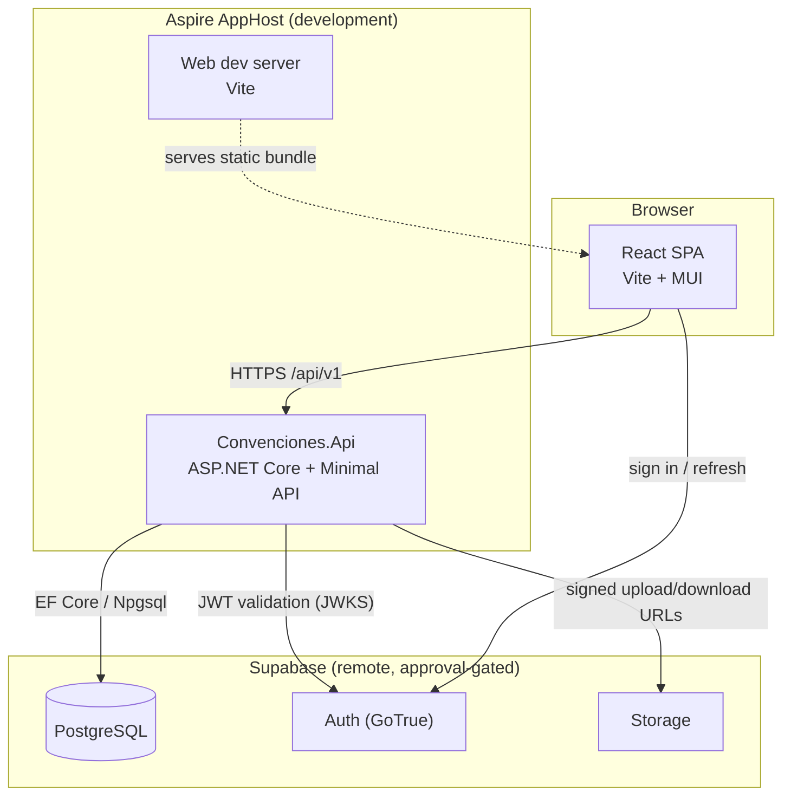
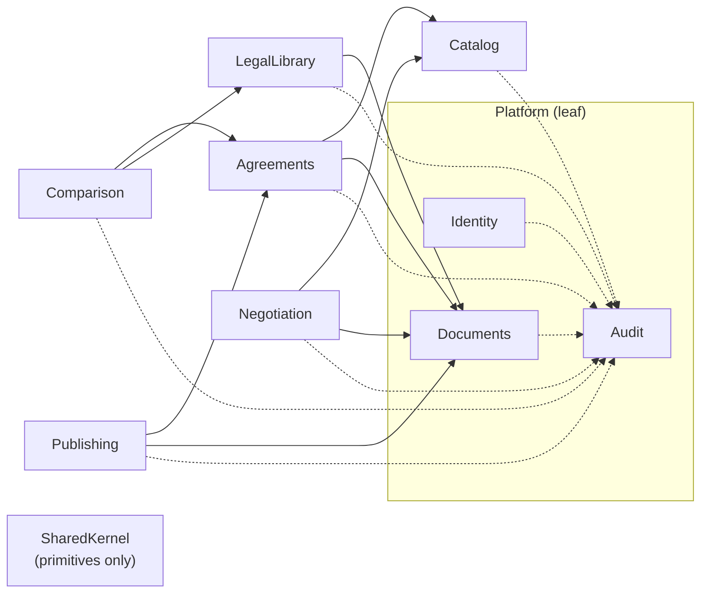
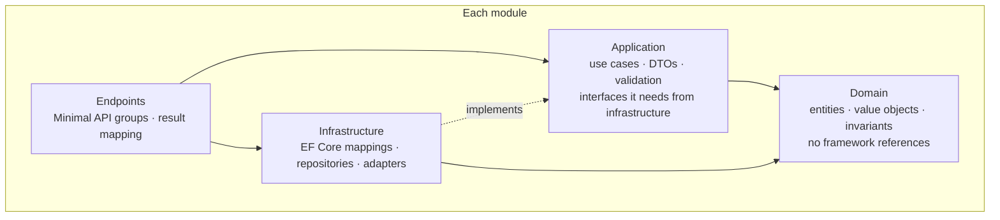
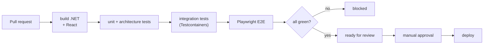

# Solution architecture — Convenciones

**Status: proposed for approval.** Decisions are recorded in [decisions.md](decisions.md) as ADRs;
the ones needing sign-off are marked **[A-nn]**.

Scope reference: [mvp-scope.md](mvp-scope.md). Domain detail: [domain-model.md](domain-model.md).
Contracts: [api-contracts.md](api-contracts.md). Security: [security-model.md](security-model.md).

---

## 1. Mandated constraints

| Constraint | Source | Consequence |
|---|---|---|
| .NET Aspire orchestrates local development | constitution Art. III | `AppHost` is the only entry point for running the stack |
| ASP.NET Core API | Art. III | Single API process for the MVP |
| PostgreSQL on Supabase | Art. III | Npgsql provider; Supabase-local for tests |
| EF Core + Npgsql data access | Art. III | No hand-written SQL layer, no second ORM |
| React + Vite + MUI | Art. III | No Tailwind, no other UI kit |
| Clean Architecture, business modules | Art. IV | Dependency direction enforced |
| No microservices | Art. IV.1 | One deployable backend |
| No CQRS / mediator / broker / generic repository by default | Phase 3 instruction | Each abstraction must be justified in §8 |

---

## 2. Architectural style

A **modular monolith**: one ASP.NET Core process, internally divided into business modules with
explicit boundaries, each module internally layered.



The API is the only component that talks to the database. The SPA talks to Supabase **only** for
authentication (issuing and refreshing tokens) and for Storage URLs the API hands it; it never
queries PostgreSQL directly. Rationale in [security-model.md](security-model.md) §4.

---

## 3. Modules

Six **business modules** and three **platform modules**. A module is a vertical slice with its own
domain model, use cases, persistence mapping and API endpoints.

### 3.1 Business modules

| Module | Owns | Does not own |
|---|---|---|
| **Catalog** | `Company`, `CompanySector`, `CompanyType`, `CompanyCategory`, `EconomicActivity`, `Country`, `State`, `Municipality` | Agreement content, identity |
| **Agreements** | `CollectiveAgreement`, `AgreementClause`, `AgreementAnnex`, publication lifecycle | Comparison queries, statute text |
| **Negotiation** | `NegotiationCase`, `NegotiationParty`, `UnionPetition`, `EmployerOffer`, `NegotiationMeeting`, `MeetingAgreement` | Agreement content (it *requests* promotion from Agreements) |
| **LegalLibrary** | `Statute`, `StatuteArticle` | Agreement clauses |
| **Comparison** | `ComparisonHeadingGroup`, `ComparisonHeading`, the comparison query surface | The entities it reads (it projects them) |
| **Publishing** | `NewsArticle`, `NewsCategory`, the public read surface | Agreement content (projects it) |

### 3.2 Platform modules

| Module | Owns |
|---|---|
| **Identity** | `UserAccount`, `UserProfile`, `Role`, `Capability`, `RoleCapability`; integration with Supabase Auth |
| **Documents** | `Document` metadata, Supabase Storage integration, upload validation |
| **Audit** | `AuditEntry`, the interceptors that populate audit columns and write state-change entries |

### 3.3 Why Comparison and Publishing are modules rather than queries inside Agreements

Both read mainly `Agreements` data, which argues for putting them inside it. I keep them separate
because each is a **feature area with its own rules**:

- **Comparison** owns the heading taxonomy — the classification vocabulary that defines what is
  comparable. Putting the taxonomy in Agreements would bury the product's core concept in a document
  CRUD module.
- **Publishing** serves an unauthenticated audience with different latency and caching
  characteristics, and holds news, which has nothing to do with agreements.

**[A-05]** Confirm or reject this split. The alternative — fold both into `Agreements` — yields four
business modules and less ceremony, at the cost of a fatter Agreements module.

### 3.4 Dependency rules



**Enforced rules** (architecture tests, §11):

1. A module may reference `SharedKernel`, `Identity` (for the current user), `Documents` and `Audit`.
2. `Comparison` may reference `Agreements` and `LegalLibrary` **read-only via their public query
   interfaces** — it may not write their data.
3. `Publishing` may reference `Agreements` read-only, same rule.
4. `Agreements` must **not** reference `Negotiation` or `Comparison`.
5. `Negotiation` must not reference `Agreements`. Promotion is requested through an **application
   interface that Agreements implements** (`IAgreementFactory`), injected at the composition root —
   so the arrow points inward from Negotiation's point of view without a compile-time reference.
6. No cycles. `SharedKernel` contains only primitives (`Entity`, `ValueObject`, `DomainException`,
   ids, clocks) — no business logic.

---

## 4. Internal layering

Each module has three layers. Clean Architecture's dependency rule applies per module, not just
globally.



The critical compile-time guarantee: **Domain references no framework type** — no EF Core attribute,
no `DbContext`, no ASP.NET Core type, no Supabase SDK. Enforced by a project reference boundary plus
architecture tests.

### 4.1 Physical layout

```
src/
  Convenciones.AppHost                  # Aspire orchestration — the only run entry point
  Convenciones.ServiceDefaults          # OTel, health checks, resilience
  Convenciones.Api                      # composition root: DI, endpoint registration, auth
  Convenciones.SharedKernel             # primitives only
  modules/
    Convenciones.Catalog                 # Domain + Application
    Convenciones.Catalog.Infrastructure  # EF mappings, migrations, adapters
    Convenciones.Agreements
    Convenciones.Agreements.Infrastructure
    Convenciones.Negotiation
    Convenciones.Negotiation.Infrastructure
    Convenciones.LegalLibrary
    Convenciones.LegalLibrary.Infrastructure
    Convenciones.Comparison
    Convenciones.Comparison.Infrastructure
    Convenciones.Publishing
    Convenciones.Publishing.Infrastructure
  platform/
    Convenciones.Identity
    Convenciones.Documents
    Convenciones.Audit
  Convenciones.Web                      # React + Vite + MUI
tests/
  Convenciones.UnitTests
  Convenciones.IntegrationTests         # Testcontainers + real PostgreSQL
  Convenciones.ArchitectureTests        # dependency rules
  Convenciones.Web.Tests                # Vitest + Playwright
```

Two projects per business module rather than the canonical three (Domain / Application /
Infrastructure). **[A-06]** Reasoning: at this size a third project per module buys only a boundary
between Domain and Application — two layers that change together and are both framework-free after
the Domain/Infrastructure split. Six modules × 3 projects = 18 projects is ceremony without benefit.
Splitting Domain from Application later is a mechanical move if it ever earns its keep.

---

## 5. Data access

### 5.1 One DbContext, one schema **[A-07]**

**Decision: a single EF Core `DbContext` over one PostgreSQL schema (`public`), with module ownership
expressed as table-name prefixes and enforced by architecture tests and review.**

I considered the alternative that is more common in modular monoliths — a `DbContext` and schema per
module — and rejected it for the MVP for one concrete reason: **the product requires cross-module
atomicity.**

Promoting a negotiation to an agreement writes `MeetingAgreement` rows (Negotiation), creates a
`CollectiveAgreement` with `AgreementClause` rows (Agreements), and appends `AuditEntry` rows
(Audit). With separate contexts that is either six migrations histories plus a distributed-transaction
workaround, or a shared connection/transaction threaded through several contexts — machinery whose
cost exceeds the benefit while the boundary is still stable.

The tradeoff is honest: **module boundaries are enforced by tests and review, not by the compiler.**
Mitigation and a revisit trigger:

- `Convenciones.ArchitectureTests` asserts that no module's Infrastructure references another
  module's entities or tables.
- Every table is prefixed with its owning module (`agreements_`, `catalog_`, `negotiation_`,
  `legal_`, `comparison_`, `publishing_`, `identity_`, `documents_`, `audit_`).
- **Revisit if** two modules begin querying each other's tables directly more than once per release.
  At that point schema-per-module (and eventually an outbox) becomes justified.

### 5.2 Rules

1. **No generic repository.** EF Core's `DbContext` is already a Unit of Work and `DbSet` a
   repository. A generic wrapper would hide the capability this product actually needs: the
   comparison query is a three-way projection over clauses, headings and agreements with ordering and
   paging, not a sequence of `GetById`/`Add` calls. Repositories are used **only** for aggregates that
   genuinely need to be loaded whole (`CollectiveAgreement` with its clauses), as
   `IAgreementRepository` with intention-revealing methods.
2. **Query handlers are classes with explicit methods**, not a pipeline. Read models for comparison
   and the public portal are projected directly with `AsNoTracking()` into DTOs.
3. **No lazy loading.** It hides N+1 problems, and the legacy system's N+1 patterns are a documented
   defect to avoid.
4. **Migrations are EF Core migrations, committed to Git**, one history, applied to Supabase only
   with explicit approval (Art. VI.4). Local and test databases are created from migrations.
5. **PostgreSQL types are used honestly** — `date`, `timestamptz`, `boolean`, enums as constrained
   `varchar` + `CHECK` or native `enum` (see [domain-model.md](domain-model.md) §2.6), `numeric` for
   money, `text` for bodies, `jsonb` only where a schema genuinely does not exist yet.
6. **Keyset pagination for lists** that grow without bound (clauses, audit); offset pagination for
   small catalogues. Rationale and contract in [api-contracts.md](api-contracts.md) §6.

---

## 6. Frontend architecture

### 6.1 Structure

```
src/Convenciones.Web/
  src/
    app/            # composition: providers, router, theme
    shared/         # api client, auth, ui primitives, hooks
    features/
      agreements/   # list · detail · editor · clause editor
      comparison/   # workspace
      catalog/      # companies + catalogues
      negotiation/  # case workspace
      legal-library/
      publishing/   # news admin + public pages
      admin/        # users, roles, capabilities
    routes/         # route tree, guards
```

Feature folders mirror the backend modules one-for-one, so a feature lives in the same neighbourhood
on both sides. **[A-08]** Confirm the mirroring convention.

### 6.2 Technology decisions

| Concern | Choice | Why |
|---|---|---|
| Build | Vite | Mandated; no SSR requirement in MVP (see Q-14 below) |
| UI | MUI v6 + Emotion | Mandated; no Tailwind |
| Routing | React Router | Standard; no framework lock-in |
| Server state | TanStack Query | Explicit cache, retries, loading/error states per query. Justified: every screen is server-state driven; hand-rolled fetch effects would be reimplemented here anyway |
| Forms | React Hook Form + Zod | Clause and agreement forms are large and need field-level errors; Zod schemas can be shared with the API contract tests |
| Client state | React context only | There is almost no client-only state beyond the session; a store library is not justified |
| Auth | Supabase JS client, token held in memory + refresh | See [security-model.md](security-model.md) §3 |

**[A-09]** TanStack Query and React Hook Form are the only two frontend dependencies beyond the
mandated set. If you want the absolute minimum, both are replaceable with hand-rolled code at a
measurable cost in review surface.

### 6.3 Screens

Detail and acceptance criteria in [mvp-scope.md](mvp-scope.md); screen-by-screen design in
[api-contracts.md](api-contracts.md) §9.

---

## 7. Asynchronous processing

**The MVP has no background jobs, no queue, and no message broker.** This is a decision, not an
omission, and follows from the requirements:

| Candidate async work | Why it is not needed in the MVP |
|---|---|
| PDF text extraction | Deferred to FUT-01; MVP clause entry is manual |
| Comparison document export | Browser print in MVP (R2-04) |
| Notifications | No requirement exists |
| Bulk import | Not in MVP (R2-07) |

Everything in W1 and W2 completes within one HTTP request. Adding a broker now would be the exact
"unnecessary complexity" the constitution forbids (Art. IV.5).

**The seam for later**, recorded so it is not designed twice: document extraction (FUT-01) is the
first genuinely asynchronous workload. The designed path is
`Document` uploaded → `POST /documents/{id}/extract` returns `202 Accepted` with an extraction id →
the SPA polls `GET /documents/{id}/extraction`. The MVP stores an `ExtractionStatus` column on
`Document` (unused, `NotRequested`) so the state model exists without the machinery. **[A-10]**

---

## 8. Abstraction justifications

Each abstraction the instruction warns about, with the decision and the reason:

| Abstraction | Decision | Justification |
|---|---|---|
| **CQRS** | **Not used** | No screen has different read/write models for the same aggregate. Comparison is a read-only projection but is a distinct feature, not the query half of an agreement command |
| **Mediator (MediatR)** | **Not used** | Endpoints call application services directly. A mediator adds a layer between endpoint and service with exactly one handler each — indirection with no dispatch variability. If the team later wants a pipeline for logging/validation, ASP.NET Core filters already provide it |
| **Message broker** | **Not used** | §7 — no asynchronous workload exists |
| **Generic repository** | **Not used** | §5.2.1 — EF Core is already the Unit of Work; the comparison projection needs real query capability |
| **Domain events** | **Not used in MVP** | The only cross-aggregate side effect is audit, which an EF interceptor handles uniformly. A dispatcher would add a transactional-outbox question we do not need to answer yet |
| **Unit of Work** | **Not used as an abstraction** | `DbContext.SaveChangesAsync()` in the use case *is* the unit of work |
| **Specification pattern** | **Not used** | Filtering is per-endpoint and explicit; there is no reused composable query |
| **Result/Either type** | **Used, narrowly** | `Result<T>` for application services to express expected failures (not found, conflict, validation) without exceptions. Justified because the API must map failures to distinct HTTP statuses and the alternative is exception-type-to-status tables |
| **Modular monolith** | **Used** | Mandated; justified by §3 boundaries |
| **Repository (specific)** | **Used for one aggregate** | `IAgreementRepository` loads the agreement aggregate with its clauses. Justified because the invariant "publish requires ≥1 clause" spans the aggregate and must be enforced on a fully loaded instance |

---

## 9. Observability and configuration

| Concern | Decision |
|---|---|
| Tracing / metrics | OpenTelemetry via `ServiceDefaults`; Aspire dashboard in development |
| Logging | Structured (`ILogger`), correlation id propagated from the SPA; **no** secrets or personal data in logs |
| Health checks | `/health/live`, `/health/ready` — readiness includes a database round-trip |
| Configuration | `appsettings.json` for non-secrets; **secrets only** from user-secrets locally and environment/Supabase config in deployed environments (Art. VI.3) |
| Failure behaviour | Fail fast at startup if the database or required configuration is missing — never start degraded and serve errors |

## 10. Testing

| Level | Tooling | What it must cover |
|---|---|---|
| Unit | xUnit + Shouldly | Domain invariants: clause ordering, publication rules, negotiation transitions, heading exclusivity |
| Integration | xUnit + `WebApplicationFactory` + **Testcontainers PostgreSQL** | Every endpoint, every authorization rule, every validation path. Real database, real migrations |
| Architecture | NetArchTest | Module dependency rules (§3.4), Domain purity |
| Frontend unit | Vitest + Testing Library | Form validation, comparison column rendering |
| End-to-end | Playwright | The W1 spine, one test per acceptance criterion in `mvp-scope.md` |

**No mocking of the database.** Art. VII.2 requires integration tests against real PostgreSQL; SQLite
in-memory would not exercise enums, `timestamptz`, or `numeric`.

## 11. CI and deployment



- **GitHub Actions**: one workflow, jobs for build, tests, E2E. A red pipeline blocks merge (Art.
  VII.3).
- **Migrations**: generated locally, reviewed in the PR, applied to Supabase **only with explicit
  approval** (Art. VI.4). CI runs migrations against a throwaway Testcontainers database, never
  against Supabase.
- **Deployment target [A-11]**: not decided here. The MVP needs only the API (container) and the
  static SPA; both are candidates for any container host. Naming a host now would be inventing a
  requirement.

## 12. Open architecture decisions requiring approval

Collected with rationale in [decisions.md](decisions.md#decisions-requiring-approval). The ones in
this document: **A-05** module split · **A-06** two projects per module · **A-07** single DbContext
and schema · **A-08** frontend feature mirroring · **A-09** two extra frontend dependencies ·
**A-10** extraction seam as a stored state · **A-11** deployment target.
