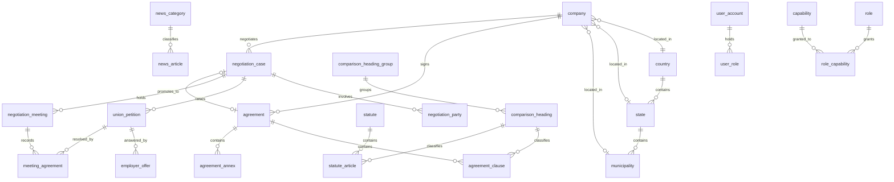

# Target schema — Convenciones

**Status: implemented and validated locally.** No remote Supabase project was touched; no data was
migrated from MySQL.

Artifacts: [supabase/config.toml](../../supabase/config.toml) ·
[supabase/migrations/](../../supabase/migrations) · [supabase/seed.sql](../../supabase/seed.sql) ·
[supabase/tests/](../../supabase/tests) · results in [validation-report.md](validation-report.md).

Design basis: [../architecture/domain-model.md](../architecture/domain-model.md) ·
[../architecture/security-model.md](../architecture/security-model.md) ·
[../database/legacy-schema-issues.md](legacy-schema-issues.md).

---

## 1. Shape at a glance

| Metric | Value |
|---|---|
| Schemas | **2** — `app` (business), `platform` (infrastructure) |
| Tables | **31** — 23 in `app`, 8 in `platform` |
| Columns | 295 |
| Primary keys | 31 (every table) |
| Foreign keys | **72**, every one with an explicit `ON DELETE` and `ON UPDATE` |
| CHECK constraints | 65 |
| Unique indexes | 62 |
| Total indexes | 95 |
| RLS policies | **160** on 31 tables — RLS enabled on every table |
| Triggers | 32 |
| Native enum types | 6 |

For comparison, the legacy schema had 35 tables, **0 foreign keys**, **1 unique constraint** (a
duplicate of a primary key), 4 secondary indexes, and no constraints of any kind beyond `NOT NULL`
and defaults. Nothing in this schema was translated from it.

## 2. Why two schemas

`app` holds business data; `platform` holds infrastructure (identity mirror, document metadata,
audit). The split exists because the two have different audiences and different failure
consequences: business tables are projected to the public portal through RLS, while platform tables
must never be readable by an anonymous caller. Separating them means the `anon` role is granted
`USAGE` on `app` only, so a policy mistake in one schema cannot expose the other.

This refines ADR-003, which specified one `DbContext` and one schema. **The DbContext remains
single** — cross-module transactions such as agreement promotion are still atomic — and the schema
split is a naming and privilege boundary, not a data-access boundary. Recorded as a delta for
review.

## 3. Tables by module

### 3.1 `app` — catalog

| Table | Purpose | Notable constraints |
|---|---|---|
| `country` | Geography level 1 | unique `lower(name)`, unique `code` when present, `code ~ '^[A-Z]{2}$'` |
| `state` | Geography level 2 | FK → `country` RESTRICT; unique `(country_id, lower(name))`; composite unique `(id, country_id)` as an FK target |
| `municipality` | Geography level 3 | FK → `state` RESTRICT; composite unique `(id, state_id)` |
| `company_sector`, `company_type`, `company_category`, `economic_activity` | Four distinct vocabularies | unique `lower(name)` each |
| `company` | The company registry | 28 columns; two composite FKs (see §5); unique `upper(tax_id)` and `legacy_code` when present; `worker_count >= 0` |

`country`, `state` and `municipality` carry no `created_by`/`updated_by`, because they are reference
data curated by an administrator rather than business records; they keep `created_at`/`updated_at`
only. **[A-43]** If reference data should also record who changed it, adding the columns is a
one-line migration.

### 3.2 `app` — comparison taxonomy

| Table | Purpose | Notable constraints |
|---|---|---|
| `comparison_heading_group` | The five blocks (GENERALES, ECONÓMICO, SOCIOECONÓMICAS, SINDICALES, SEGURIDAD OCUPACIONAL) | `requires_economic_comparison boolean`; unique `lower(name)`; `sort_order` |
| `comparison_heading` | Individual headings | FK → group RESTRICT; unique `(group_id, lower(name))`; `is_excluded boolean` |

A trigger (`comparison_heading_exclusion_consistency`) rejects an `is_excluded` heading inside a
group that requires economic comparison — a contradiction the legacy data model could express.

### 3.3 `app` — legal library

| Table | Purpose | Notable constraints |
|---|---|---|
| `statute` | One statute, `kind` ∈ {LabourLaw, OtherStatute} | **partial unique index** allows at most one LabourLaw; unique `lower(name)` |
| `statute_article` | Articles | FK → statute CASCADE; unique `(statute_id, number_int, coalesce(number_suffix,''))`; `heading_id` **nullable** |

Article counts are computed, never stored. The legacy `total_articulos` column was maintained by
application code and drifted.

### 3.4 `app` — agreements

| Table | Purpose | Notable constraints |
|---|---|---|
| `agreement` | Collective agreement header | FK → company RESTRICT; unique `(company_id, valid_from)`; `valid_to >= valid_from`; publication consistency CHECK |
| `agreement_clause` | Clause body and classification | FK → agreement CASCADE; FK → heading RESTRICT, **NOT NULL**; unique `(agreement_id, number_int, coalesce(number_suffix,''))`; `number_int >= 1`; suffix `^[A-Z]{1,2}$`; exclusion-note consistency |
| `agreement_annex` | Annexes | FK → agreement CASCADE; FK → document SET NULL; unique `(agreement_id, lower(name))` |

Publication is a state plus an actor plus a timestamp, tied together by a CHECK so a half-published
agreement cannot exist:

```sql
constraint agreement_publication_consistency check (
    (state = 'Published' and published_at is not null and published_by is not null)
    or
    (state = 'Draft'     and published_at is null     and published_by is null)
);
```

### 3.5 `app` — negotiation

| Table | Purpose | Notable constraints |
|---|---|---|
| `negotiation_case` | A negotiation for one company | `closed_at` and `promoted_agreement_id` consistency CHECKs; **unique `promoted_agreement_id`** (one agreement cannot be produced by two cases) |
| `negotiation_party` | Representatives as rows, not columns | FK → case CASCADE; `role` enum; email regex |
| `union_petition` | Petitions | FK → case CASCADE; unique `(case_id, number…)`; composite unique `(id, case_id)` as an FK target |
| `employer_offer` | Offers, one petition each | FK → petition CASCADE; unique `(petition_id, number…)` |
| `negotiation_meeting` | Meetings | FK → case CASCADE; composite unique `(id, case_id)` |
| `meeting_agreement` | Agreements reached in a meeting | **two composite FKs** (see §5) |

### 3.6 `app` — publishing

| Table | Purpose | Notable constraints |
|---|---|---|
| `news_category` | News categories | unique `lower(name)` |
| `news_article` | News | FK → category RESTRICT; same publication consistency CHECK as agreements; two optional document FKs |

### 3.7 `platform` — infrastructure

| Table | Purpose | Notable constraints |
|---|---|---|
| `user_account` | Authorisation record mirroring a Supabase Auth user | `id` = JWT `sub`; unique `lower(email)`; `is_blocked`, `expires_on` |
| `user_profile` | Optional profile | 1:1 by PK; FK → `app.company` SET NULL |
| `role` | Four roles + `is_system` marker | unique `key`; `key ~ '^[a-z][a-z0-9_]*$'` |
| `capability` | 22 capability keys | unique `key`; `key ~ '^[a-z][a-z0-9_]*\.[a-z][a-z0-9_]*$'` |
| `role_capability` | Grants | PK `(role_id, capability_id)` — the legacy grant table had no uniqueness |
| `user_role` | Assignments | PK `(user_id, role_id)`; `granted_by` |
| `document` | File metadata only | unique `storage_path`; content-type allow-list; size ≤ 20 MiB; `checksum_sha256` format |
| `audit_entry` | Append-only event log | `module` allow-list; `changes` must be a JSON object; **append-only trigger** |

## 4. Relationship cardinalities



**One-to-one:** `user_profile` ↔ `user_account`; `negotiation_case` → `agreement` (at most one, via
unique `promoted_agreement_id`).

**Many-to-many:** `role` ↔ `capability` (through `role_capability`), `user_account` ↔ `role`
(through `user_role`). These are the only junction tables — the legacy system's three meeting
junctions were unnecessary because a petition and a meeting both already belong to a case.

## 5. Integrity beyond simple foreign keys

Two composite-FK techniques do work that the legacy schema could not express at all.

### Geography hierarchy consistency

```sql
constraint company_state_country_fk foreign key (state_id, country_id)
    references app.state (id, country_id),
constraint company_municipality_state_fk foreign key (municipality_id, state_id)
    references app.municipality (id, state_id)
```

A company cannot claim to be in Venezuela, in the state of Zulia, in a municipality of Trujillo.
Test C1 and C2 in [validation-report.md](validation-report.md) prove both rejections.

Because a composite FK with a NULL component is not enforced (MATCH SIMPLE), the single-column FKs
`company_state_id_fkey` and `company_municipality_id_fkey` are **kept deliberately**: they guarantee
that a state reference is valid even when `country_id` is unknown. Removing them would open a hole.

### Same-case consistency for negotiation

```sql
constraint meeting_agreement_petition_fk foreign key (petition_id, case_id)
    references app.union_petition (id, case_id),
constraint meeting_agreement_meeting_fk foreign key (meeting_id, case_id)
    references app.negotiation_meeting (id, case_id)
```

An agreement cannot cite a petition from case A and a meeting from case B. The legacy `acuerdos`
table carried four sibling pointers with nothing tying them together, and 3 of 4 offers in the data
pointed at petitions that no longer existed.

## 6. Delete and update policy

Every foreign key states its rule; the verification asserts that **zero** FKs are left on the
database default.

| Rule | Applied to | Rationale |
|---|---|---|
| `ON DELETE CASCADE` | clauses and annexes → agreement; articles → statute; parties, petitions, offers, meetings, meeting agreements → case; role/user grants | A child has no meaning without its parent |
| `ON DELETE RESTRICT` | agreement → company; case → company; clause → heading; article → heading; statute → document; user → documented records | Deleting these would destroy or orphan business history. The legacy system hard-deleted and left 57 clauses pointing at a deleted agreement |
| `ON DELETE SET NULL` | `created_by` / `updated_by`; optional document links; `user_profile.company_id`; `audit_entry.actor_id` | The record survives its author |
| `ON UPDATE` | always `RESTRICT` on every FK | Keys are immutable; a cascading rename is never correct |

## 7. Timestamps, auditing and soft deletion

| Concern | Decision | Justification |
|---|---|---|
| `created_at` / `updated_at` | Every table, `timestamptz not null default now()`, `updated_at` maintained by trigger | 32 triggers; no code path can forget it |
| `created_by` / `updated_by` | Every **business** table, nullable FK to `user_account` | Nullable because reference data and migrations have no actor |
| Soft deletion | **`platform.document.deleted_at` only** | Audit entries and agreement history may reference a document after its bytes are removed |
| Soft deletion elsewhere | **None** | Business tables use real constraints instead. `company.archived_at` exists for hiding a company without deleting it, and `ON DELETE RESTRICT` blocks deleting a company that has agreements. Nothing else needed it — the legacy system had no soft delete either |

The `platform.audit_entry` table is append-only, enforced by a trigger that raises on `UPDATE` and
`DELETE`, and by the absence of any update or delete policy.

## 8. Row Level Security

RLS is enabled on **all 31 tables**; there is no unprotected table (verified). 160 policies.

### 8.1 The three roles

| Role | Reads | Writes |
|---|---|---|
| `anon` | Reference geography, company identity, published agreements and their clauses/annexes, published news | Nothing |
| `authenticated` | All `app` tables (row-filtered), own identity data, role/capability catalogue | **Nothing** — SELECT-only grants |
| `app_api` | Everything an active user may read | DML, each table gated by a capability |

The API connects as `app_api` and sets the caller's claims per request:

```sql
SET LOCAL request.jwt.claims = '{"sub":"<user-uuid>"}';
```

`platform.current_user_id()` reads the `sub` claim; `platform.is_active_user()` and
`platform.has_capability()` evaluate account state and grants. Both are `SECURITY DEFINER` with a
pinned `search_path`, so they can read identity tables from inside policies without recursing and
without being hijackable.

### 8.2 Authorisation is not a `tenant_id` check

The Phase 4 requirement is explicit that a tenant column is not sufficient. This schema is
single-tenant (approval item A-04), so isolation is expressed as three separate questions:

1. **Who** — an actual identity from the token (`sub`), never a client-supplied id.
2. **May they act** — provisioning, blocking, expiry and an explicit capability grant, all checked
   in the database on every statement.
3. **Which rows** — policy predicates, including the same-case composite rules.

A `WHERE tenant_id = current_tenant()` predicate would answer only (3), and would still be bypassed
by a caller who could influence `current_tenant()`.

### 8.3 The bootstrap window as a policy

`platform.user_account`'s INSERT policy is:

```sql
with check (not platform.has_any_user() or platform.has_capability('user.manage'));
```

While the database has no users, exactly one account can be created through the API — the
SuperAdmin required by constitution Art. VI.6. Once any user exists the window is closed, and
creating another requires `user.manage`. Tests R1 and R2 prove both halves. No migration, seed file
or test seeds a user account.

### 8.4 Privileged transitions guarded in the database

RLS filters rows, not columns, so two state transitions get triggers that call the same capability
function:

- publishing or unpublishing an agreement requires `agreement.publish`;
- promoting a negotiation case requires `negotiation.promote`.

Test R15 proves the publication guard rejects a caller holding `agreement.write` without
`agreement.publish`. The legacy system had exactly one such gate and it was commented out.

### 8.5 What RLS does *not* do — a finding from the test run

Writing the tests exposed an important behaviour: **`UPDATE`, `DELETE` and `SELECT` whose `USING`
clause fails affect zero rows silently; only an `INSERT` whose `WITH CHECK` fails raises an error.**
That is secure — nothing is changed — but invisible to the caller.

**Consequence for the API layer:** every mutating endpoint must inspect the affected row count and
map zero to `404 not_found` (or `403`), rather than assuming success. This is recorded in
[validation-report.md](validation-report.md) §5 and must reach the API task.

## 9. Seed data

`supabase/seed.sql` contains only what the application needs to function:

| Seeded | Rows | Why |
|---|---|---|
| Capabilities | 22 | Code-owned keys the API's endpoint policies reference |
| Roles | 4 | Administrator, Editor, Analyst, Negotiator |
| Role→capability grants | 53 | The capability matrix |
| Comparison heading groups | 5 | The classification vocabulary the product cannot operate without |
| One heading ("No Compara") | 1 | So the exclusion concept is representable from day one |
| Country Venezuela | 1 | Minimum viable geography |

**Not seeded:** any user (Art. VI.6), the 64 legacy headings, 237 countries, 23 states, 410
municipalities, or any other legacy record. Reproducing those would be a data migration, which the
constitution forbids (Art. V.2).

## 10. Supabase integration

| Aspect | Decision |
|---|---|
| Auth | **Supabase Auth owns credentials.** No password column, hash or reset token exists here. `user_account.id` mirrors the JWT `sub` |
| Sign-up | Disabled in `config.toml` (`enable_signup = false`, and under `[auth.email]`) — approval item A-35 |
| PostgREST | **Disabled** (`[api] enabled = false`). The SPA never queries PostgreSQL directly; every read and write goes through the API. A second unmedalled data path would duplicate authorisation and sanitisation |
| Storage | Enabled, 20 MiB limit matching `platform.document`; buckets are private and files are served only through API-issued signed URLs |
| Migrations | Applied by the Supabase CLI in filename order, or by any `psql` client. They contain no Supabase-specific syntax, which is why they run unchanged on a plain PostgreSQL 17 instance |

### Deliberate absence of an FK to `auth.users`

`user_account` does **not** reference `auth.users(id)`. Reasons: that schema is Supabase-managed, is
absent from a plain PostgreSQL instance (which is how this schema is validated), and referencing it
would couple our migrations to a Supabase internal. The consequence is documented honestly: **a
Supabase Auth user could exist without an authorisation record.** Such a user is harmless — with no
profile, every read returns zero rows and every write is refused (test R10) — but provisioning is
the API's responsibility and should be asserted by an integration test.

## 11. Limitations

1. **The Supabase CLI was not executed.** It is not installed in this environment. `config.toml`
   targets CLI 2.122.0 (current release) and follows its documented schema, but `supabase start`
   has not been run, so Supabase-specific behaviour (GoTrue, Storage, the PostgREST surface) is
   unverified here.
2. **RLS was validated against a plain PostgreSQL 17.11 instance**, with roles and claims simulated
   via `SET LOCAL ROLE` and `set_config('request.jwt.claims', …)`. This exercises the policies
   themselves faithfully, but not the exact claim shape Supabase issues in every deployment.
3. **No full-text search, no trigram indexes, no partitioning.** None is required by an MVP
   requirement; adding indexes without a measured query would be guesswork.
4. **Tenant isolation is single-tenant by decision.** §8.2 explains what a future tenant dimension
   would require: a column, a JWT claim, and a predicate added to every policy — a schema-wide
   change, not an incremental one.
5. **`platform.user_profile.company_id` is the only company scoping.** Approval item A-37 asks
   whether negotiators should be restricted to their own company's cases; the column exists and is
   enforced nowhere yet.
6. **No `updated_by`/`created_by` on reference tables** (§3.1, [A-43]).
7. **Enum evolution** requires `ALTER TYPE ... ADD VALUE`, which cannot run inside a transaction
   block before PostgreSQL 12. On 17 it can, but adding a value is still a migration and should be
   treated as a state-machine change.
